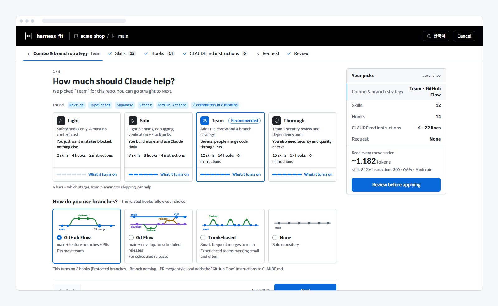
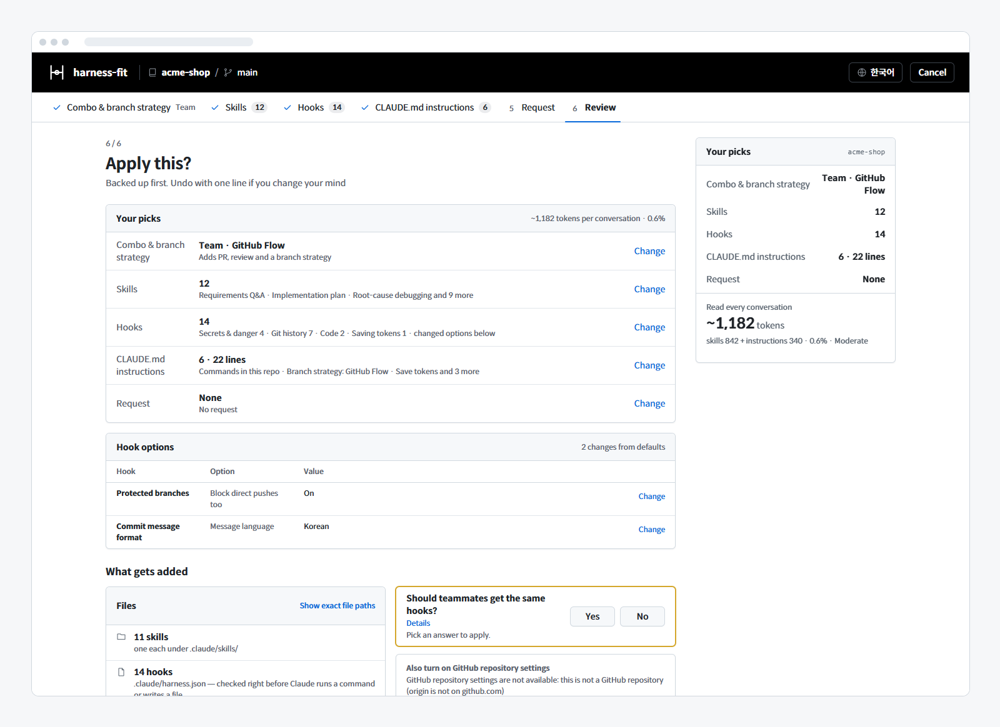

<div align="center">

# harness-fit

### Find the skills, hooks and rules your project actually needs.

Just started with Claude Code and not sure what to install?<br>
It reads your repo and walks you through picking the skills, hooks and CLAUDE.md instructions that fit — step by step.<br>
<sub>A harness is the set of skills, hooks and instructions Claude works within. This fits one to your project.</sub>

[](LICENSE)
[](https://nodejs.org)
[](#claude-code)


[](#your-data-stays-on-your-machine)

[한국어](README.md) · **English**



</div>

---

It reads your repo (stack, team size, branches) and preselects a combo. Click "Next" through to the review step and press "Apply", or change only what you want on the way.

## Requirements

- **Claude Code v2.1.139 or later** (the hooks use the exec form with `args`, added in that version). Tested on 2.1.318.
- Node 18 or later (the hooks and the picker run on Node).

## Claude Code

Install once.

```
/plugin marketplace add HwangSlater/harness-fit
/plugin install harness-fit@harness-fit
```

Then, in your project:

```
/harness-fit:setup
```

No need to describe your project: it reads the repo (package.json, recent committers, branches, CI) and preselects the recommended combo. If there is nothing to read yet, such as a brand-new empty repo, it first asks whether to start from the default set or hear what you're building (e.g. "Next.js + Supabase, 3 people"). When it's applied, Claude summarizes the result and continues with what's left.

| Command | What it does |
| --- | --- |
| `/harness-fit:setup` | Open the picker |
| `/harness-fit:setup auto` | No browser: review the recommendation and apply (remote/SSH) |
| `/harness-fit:setup undo` | Undo the last apply |

To just look around without the plugin, run `npx github:HwangSlater/harness-fit`. Hooks only run through the plugin, though, so applying this way writes the settings file but blocks nothing.

## What you do on the screen (6 steps)

1. **How much should Claude help?** Pick Light · Solo · Team · Thorough and a branch strategy (GitHub Flow · Git Flow · Trunk-based · None), each drawn as a git graph. Stack-specific skills are added automatically.
2. **Which skills should go in?** Click chips to turn skills on or off in each stage, from planning to shipping. "Details" gives each skill a plain one-line effect and a "Keep in mind" note.
3. **Which mistakes should be blocked?** The 26 hooks in 6 groups. "Details" shows what each one blocks. Commit message format and branch naming are only on by default when the repo's history already follows them. Commands to confirm first (deploy or training scripts, …) and paths to protect that it finds in the repo are filled into the options, each with the reason it was found.
4. **Which instructions go into CLAUDE.md?** The exact text that will be written is previewed. The top block, "Commands in this repo", holds the test, lint and build commands read from your repo. Click an instruction to see all of its lines in a small dialog.
5. **Anything else?** Write "commit messages in English" and Claude applies it after setup.
6. **Apply this?** See what gets added where and which hook options differ from the defaults, then press "Apply".

<div align="center">

</div>

Reopening starts from your previous selection. Each step is explained in the [guide · the 6 steps](docs/guide.en.md#the-6-steps-in-detail).

## What goes where?

| What | Where | What it does |
| --- | --- | --- |
| Skills | `.claude/skills/<name>/` | Ways of working Claude reads only when needed, downloaded at a version pinned to a commit. |
| Hooks | `.claude/harness.json` | The hook program is this plugin; the file only lists which hooks are on, their options and your last selection. |
| Git pre-commit hook | `.git/hooks/pre-commit` | Re-checks what actually goes into each commit with the same hooks. |
| CLAUDE.md instructions | marked block in `CLAUDE.md` | Read every conversation. Existing text stays. |
| Teammate install prompt | `.claude/settings.json` | Teammates who open the repo are prompted to install this plugin (pinned version). |
| Request note | `.claude/harness-request.md` | What you typed on the screen; Claude reads and applies it. |
| Backup | `.claude/harness-backup/` | The original of every changed file, used for undo. |

Nothing you already have (hooks, skills, CLAUDE.md) is added twice ([how it compares](docs/guide.en.md#when-you-already-have-something)).

## How many tokens?

Skills keep only a name and one-line description until used. Hooks send Claude about one line (roughly 20–100 tokens) only when they fire; the one hook that adds text routinely, "Work checklist", is off by default ([details](docs/guide.en.md#tokens-used-by-hooks)). These are the "Read every conversation" numbers from the picker's summary card for an example Next.js · TypeScript · Supabase · Vitest · GitHub Actions repo with 3 committers (skill one-liners + CLAUDE.md instructions, roughly 4 English characters per token).

| Combo | Skills · hooks · instructions | Per conversation |
| --- | --- | --- |
| Light | 0 · 4 · 2 | ~116 tokens (0.1%) |
| Solo | 9 · 8 · 4 | ~944 tokens (0.5%) |
| Team (recommended for this repo) | 12 · 14 · 6 | ~1,182 tokens (0.6%) |
| Thorough | 15 · 17 · 6 | ~1,403 tokens (0.7%) |

The percentage is the share of what Claude can hold at once (200k tokens). If you pick too many skills, the review step tells you ([skill listing limit](docs/guide.en.md#skill-listing-limit)).

## Undo

```
/harness-fit:setup undo
```

Or `npx github:HwangSlater/harness-fit --undo`. Restores the state before the last apply. Files you edited after setup are not wiped; your edits are kept in the backup folder ([details](docs/guide.en.md#undo-in-detail)).

## Your data stays on your machine

The picker runs only on your machine (`127.0.0.1`) and checks a one-time token on every data request. The only outgoing requests are downloading skill files, searching GitHub for new repositories, and — if origin is on GitHub and `gh` is logged in — reading the repository settings when the picker opens (`gh api`, read-only). Requests that change settings are sent only when "Also turn on GitHub repository settings" is on. No code or file contents are sent anywhere.

## FAQ

**Which skills fit my project?**<br>
It reads the repo, preselects a combo and adds skills for your stack (e.g. Next.js → React performance, Supabase or Postgres → Postgres table & index rules, MCP SDK → Build an MCP server). The rest are under "See all skills" in step 2 (78 — the 3 that do a hook's job are left out).

**Won't more skills cost tokens in every conversation?**<br>
Only skill names, one-line descriptions and the CLAUDE.md instructions are read every conversation, and the picker shows that amount as you choose. Team in the example above is about 1,182 tokens (0.6%).

**"Don't `git add .`", "don't commit to main"… do I have to say this every time?**<br>
No. A hook blocks the command and tells Claude why in one line (Block git add -A, Protected branches). What a hook enforces is not repeated in CLAUDE.md.

## Learn more

- [Mistakes it blocks — the 26 hooks](docs/guide.en.md#the-26-hooks)
- [Hook options](docs/guide.en.md#hook-options)
- [Git pre-commit hook](docs/guide.en.md#git-pre-commit-hook)
- [Letting one line through (`lint:allow`)](docs/guide.en.md#letting-one-line-through)
- [When a hook crashes](docs/guide.en.md#when-a-hook-crashes)
- [Working with teammates](docs/guide.en.md#working-with-teammates)
- [GitHub repository settings (opt-in)](docs/guide.en.md#github-repository-settings)
- [Where do the skills come from?](docs/guide.en.md#where-do-the-skills-come-from)
- [Working on this repo (test commands)](docs/guide.en.md#working-on-this-repo)

## License

[MIT](LICENSE) © [HwangSlater](https://github.com/HwangSlater)
