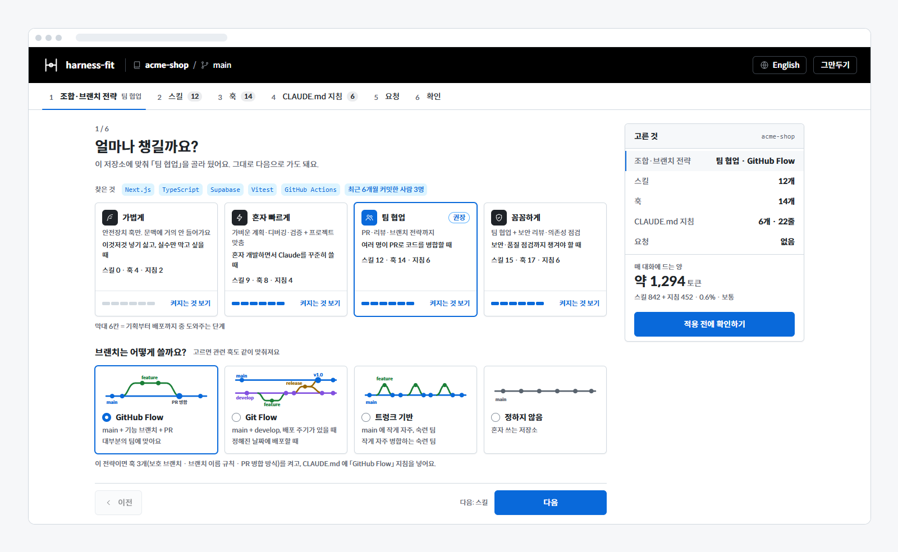
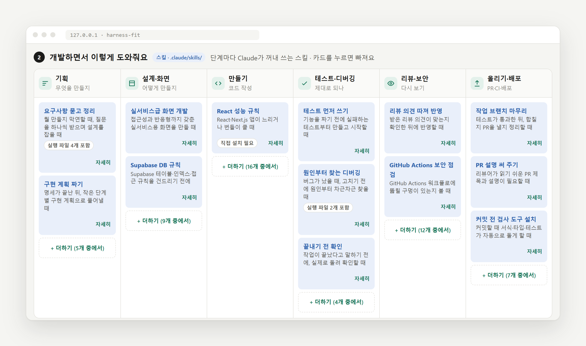
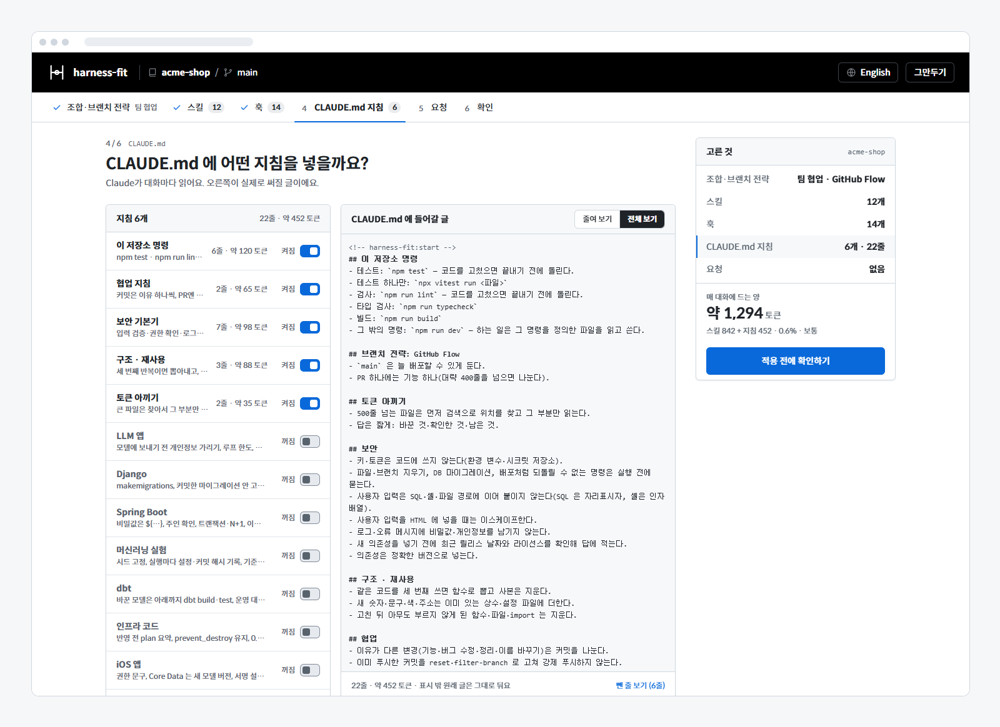
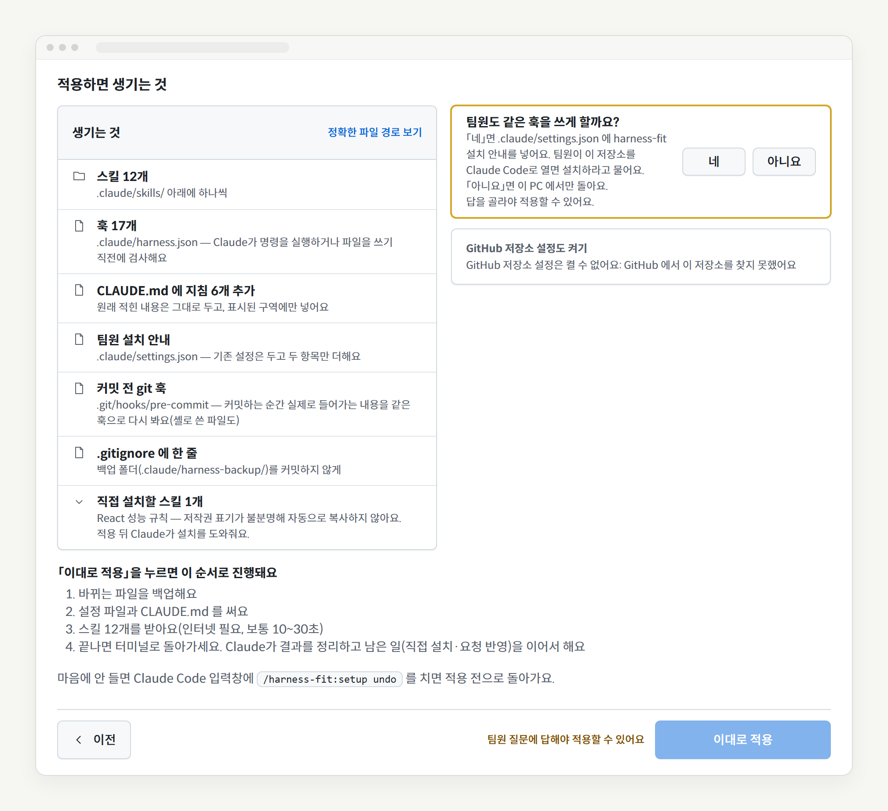
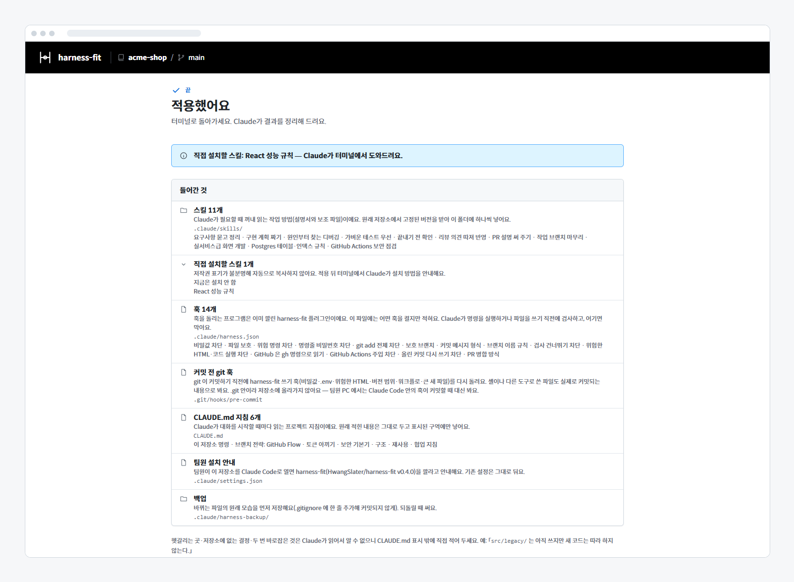
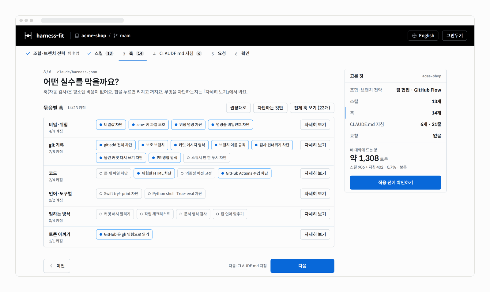

<div align="center">

# harness-fit

### Find the skills, hooks and rules your project actually needs.

Claude Code 를 처음 쓸 때, 뭘 깔아야 할지 고민하지 마세요.<br>
저장소를 읽고, 내 프로젝트에 맞는 스킬·훅·CLAUDE.md 지침을 단계별 화면에서 골라 설치해 줘요.<br>
<sub>하네스(harness) = Claude 가 일하는 틀이 되는 스킬·훅·지침 묶음. 그걸 내 프로젝트에 맞춰(fit) 줘요.</sub>

[](LICENSE)
[](https://nodejs.org)
[](#claude-code-에서-쓰기)


[](#내-데이터는-내-컴퓨터에)

**한국어** · [English](README.en.md)



</div>

---

## 스킬, 훅, CLAUDE.md… 뭘 깔아야 하죠?

Claude Code 를 깔고 나면 이런 말이 쏟아져요.

- GitHub 에 스킬 저장소가 수십 개인데, **내 프로젝트엔 뭐가 맞지?**
- 많이 깔면 좋을 줄 알았는데, **대화마다 토큰을 먹는다고?**
- `git add .` 하지 말라, main 에 바로 커밋하지 말라… **이걸 매번 말로 해야 해?**

**harness-fit** 은 저장소를 읽어서(스택·팀 규모·브랜치) 맞는 조합을 미리 골라 둬요. 「다음」만 눌러 확인 단계까지 가서 「이대로 적용」하면 끝이고, 바꾸고 싶은 것만 눌러서 바꾸면 돼요.

## 바로 시작하기

```bash
npx github:HwangSlater/harness-fit
```

지금 폴더의 저장소를 읽고 브라우저에 고르기 화면이 열려요(`cli/harness-fit.js`). 둘러보기용이에요 — 훅은 플러그인으로만 돌아서, 플러그인 없이 적용하면 설정 파일만 생기고 아무것도 막지 않아요(화면에 알리고, CLAUDE.md 지침은 훅이 꺼진 것으로 보고 글로 넣어요). 실제로 쓰려면 아래 「Claude Code 에서 쓰기」로 깔아 주세요.

## Claude Code 에서 쓰기

**Claude Code v2.1.139 이상**이 필요해요(훅을 셸 없이 부르는 `args` 꼴이 이 버전부터 있어요). 2.1.318 에서 시험했어요. 한 번만 설치하세요.

```
/plugin marketplace add HwangSlater/harness-fit
/plugin install harness-fit@harness-fit
```

그다음 프로젝트에서

```
/harness-fit:setup
```

따로 설명하지 않아도 저장소(package.json, 커밋한 사람 수, 브랜치, CI 설정)를 읽고 권장 조합을 골라 둬요. 막 만든 빈 저장소처럼 읽을 게 없으면 맞춤 권장을 할 수 없다고 먼저 알려 주고, 기본 조합으로 갈지 무엇을 만드는지(예: 「Next.js + Supabase, 3명」) 알려 줄지 물어봐요.

적용이 끝나면 Claude 가 결과를 정리하고, 남은 일(직접 설치할 스킬, 화면에 적어 둔 요청)을 이어서 해 줘요.

| 명령 | 하는 일 |
| --- | --- |
| `/harness-fit:setup` | 고르기 화면 열기 |
| `/harness-fit:setup auto` | 화면 없이 권장 조합을 보고 적용(원격·SSH 환경) |
| `/harness-fit:setup undo` | 마지막 적용 되돌리기 |

## 화면에서 하는 일 (6단계)

한 화면에 질문 하나씩, 위쪽 단계 탭이나 오른쪽 「고른 것」 요약에서 아무 단계로나 바로 갈 수 있어요. 단계마다 주소(`#combo` …)가 있어 브라우저의 뒤로 가기도 돼요.

<div align="center">

</div>

1. **얼마나 챙길까요?** (조합·브랜치 전략) 가볍게 · 혼자 빠르게 · 팀 협업 · 꼼꼼하게 중 하나. 카드마다 「켜지는 것 보기」로 들어갈 스킬·훅·지침을 미리 봐요. 스택에 맞는 스킬(React, Supabase, GitHub Actions…)은 자동으로 더해져요. 같은 화면 아래에서 **브랜치 전략**(GitHub Flow · Git Flow · 트렁크 기반 · 정하지 않음)을 고르면 관련 훅도 같이 맞춰져요.
2. **어떤 스킬을 넣을까요?** 기획 → 설계·화면 → 만들기 → 테스트·디버깅 → 리뷰·보안 → 올리기·배포 묶음마다 칩을 눌러 켜고 꺼요. 「추가로 권장」은 저장소 스택에 맞춘 것, 「전체 스킬 보기」는 81개 전체를 찾아보는 창이에요.
3. **어떤 실수를 막을까요?** 훅 23개를 6개 묶음(비밀·위험 / git 기록 / 코드 / 언어·도구별 / 일하는 방식 / 토큰 아끼기)으로 보여 줘요. 「자세히 보기」에서 무엇을 차단하는지, 훅 옵션을 봐요. 「차단하는 것만」을 누르면 명령·파일 쓰기를 차단하는 훅만 켜고, 알려 주기만 하는 훅(커밋 해시 알리기·작업 체크리스트·답 언어 맞추기)은 꺼요.
4. **CLAUDE.md 에 어떤 지침을 넣을까요?** 켠 훅에 맞춰 실제로 써질 글을 오른쪽에 미리 보여 줘요(줄여 보기 / 전체 보기). 맨 위 **「이 저장소 명령」**은 package.json scripts(pnpm·yarn·bun 잠금 파일이면 그 명령으로)·Makefile·pyproject(pytest·ruff·mypy·tox·hatch)·Cargo·go.mod 에서 읽은 시험·검사·타입 검사·형식·빌드 명령이에요. 저장소에 있는 것만 넣고, 하나도 없거나 내 CLAUDE.md 에 이미 적혀 있으면 넣지 않아요. 시험 도구를 확실히 알 수 있으면(vitest·jest·Playwright·bun·node --test·pytest·cargo·go) 「시험 하나만」 명령도 넣어요. 「줄을 대신 맡는 훅」 칩을 켜면 그 훅이 차단하니 겹치는 줄이 빠지고, 「뺀 줄 보기」로 훅·스킬이 맡아서(또는 이미 CLAUDE.md 에 있어서) 뺀 줄을 줄 그어 이유와 함께 볼 수 있어요. 헷갈리는 곳·저장소에 없는 결정·두 번 바로잡은 것은 Claude 가 저장소를 읽어도 모르니, harness-fit 표시 밖에 직접 적어 두세요(예: 「`src/legacy/` 는 아직 쓰지만 새 코드는 따라 하지 않는다.」).

<div align="center">

</div>

5. **더 바라는 게 있나요?** 「커밋 메시지는 한국어로 써 줘」처럼 적어 두면 적용 뒤 Claude 가 반영해요.
6. **이대로 적용할까요?** 고른 것마다 「바꾸기」로 돌아갈 수 있고, 무엇이 어디에 생기는지 보여 줘요. 적용은 이 단계의 「이대로 적용」 단추로만 해요(요약 카드의 「적용 전에 확인하기」는 이 단계로 데려가요).

브랜치 전략을 정했으면 확인 단계에서 **「팀원도 같은 훅을 쓰게 할까요?」**에 꼭 답해야 적용돼요. 「네」면 `.claude/settings.json` 에 설치 안내를 넣고, 팀원이 할 일(커밋·푸시할 파일, 저장소를 열면 뜨는 설치 안내, git 커밋 전 훅은 팀원 PC 에서 따로 적용해야 한다는 점)을 적용 전·후에 보여 줘요.

<div align="center">

</div>

**다시 열면 지난번 선택에서 시작해요.** 이미 적용한 프로젝트에서 `/harness-fit:setup` 을 다시 열면 새 권장이 아니라 지난번에 적용한 것(끈 훅은 꺼진 채)에서 시작하고, 그 뒤 새로 생긴 스킬·훅·지침은 꺼진 채 「새로 생김」으로 표시해요. 「권장으로 되돌리기」를 누르면 같은 자리에 「이전 선택으로 돌리기」가 떠요. `auto` 도 지난번 선택을 지키고 새것은 이름만 알려요.

## 무엇이 어디에 들어가나요?

적용이 끝나면 무엇이 어디에 들어갔는지 종류별로 보여 줘요.

<div align="center">

</div>

| 무엇 | 들어가는 곳 | 하는 일 |
| --- | --- | --- |
| 스킬 | `.claude/skills/<이름>/` | Claude 가 필요할 때만 꺼내 읽는 작업 방법. 원래 저장소에서 커밋 해시로 고정한 버전을 받아요. |
| 훅 | `.claude/harness.json` | 훅 프로그램은 이 플러그인이에요. 파일엔 어떤 훅을 켤지와 옵션, 지난번 선택만 적혀요. |
| 커밋 전 git 훅 | `.git/hooks/pre-commit` | 커밋하는 순간 실제로 들어가는 내용을 같은 훅으로 다시 봐요(셸로 쓴 파일도, Claude 밖에서 한 커밋도). |
| CLAUDE.md 지침 | `CLAUDE.md` 의 표시된 구역 | Claude 가 대화마다 읽어요. 원래 적힌 내용은 그대로 둬요. |
| 팀원 설치 안내 | `.claude/settings.json` | 팀원이 저장소를 열면 이 플러그인(버전 고정)을 깔라고 안내해요. 기존 설정은 두고 두 항목만 더해요. |
| 요청 메모 | `.claude/harness-request.md` | 화면에 적은 요청. Claude 가 읽고 반영해요. |
| 백업 | `.claude/harness-backup/` | 바뀌는 파일의 원래 모습. 되돌릴 때 써요(`.gitignore` 에 한 줄 더해 커밋되지 않게). |

### 이미 있는 것과 겹치면 넣지 않아요

- **훅**: 이미 쓰는 훅(전역·프로젝트 설정, 다른 플러그인)에 시험 입력을 실제로 넣어 봐요. 같은 것을 막으면 harness-fit 쪽 훅은 꺼진 채로 시작하고 화면에 알려요. 쓰기 전에 막는 훅(PreToolUse)과 Stop·SessionStart·UserPromptSubmit 훅을 같은 때끼리 견주고, 쓴 뒤에 알려 주는 훅(PostToolUse)은 같은 것으로 보지 않아요. 이 시험은 임시 저장소·임시 홈 폴더에서 몇 초 걸리고, 기존 훅마다 시험 입력 수만큼(수십 번) 불려서 로그를 남기는 훅이면 그만큼 기록이 남아요. 저장소에 들어 있는 훅은 Claude Code 안에서 열 때만 돌려 봐요.
- **스킬**: 같은 이름의 스킬이 이미 있으면 빼요. 이름은 달라도 하는 일이 같은 스킬은 설치를 시작할 때 Claude 가 이름과 설명을 보고 골라내요.
- **CLAUDE.md**: 프로젝트나 전역 CLAUDE.md 에 이미 같은 말이 있는 줄은 Claude 가 보고 빼요. 훅이 막아 주는 일은 지침 글로 다시 적지 않아요.
- **팀원 공유를 켜면** 이 PC 에만 있는 훅·스킬(전역 설정)은 겹침으로 보지 않아요. 팀원에게는 없으니까요.
- harness-fit 안에서도 같은 일을 하는 스킬(예: 「테스트 먼저 쓰기」와 「가벼운 테스트 우선」)은 조합에 함께 넣지 않아요(`catalog/overlaps.json`).

### GitHub 저장소 설정 (원할 때만)

훅은 Claude 가 치는 명령만 봐요. GitHub 웹 화면에서 병합하거나, `gh api` 로 보내거나, 다른 사람이 병합하는 길은 막지 못해요. 그래서 확인 단계에 「GitHub 저장소 설정도 켜기」를 뒀어요. **기본은 꺼짐**이고, 켜면 아래 항목을 하나씩 골라요. 권장 값이 미리 골라져 있지만 맞는 답은 팀마다 달라서 켜고 끄는 것은 직접 정해요. 이 저장소를 함께 쓰는 모든 사람에게 적용되니, 고른 항목의 바뀌는 값(지금 → 바뀐 뒤)을 보여 준 뒤에만 바꿔요.

| 항목 | GitHub Flow 권장 | Git Flow 권장 | 트렁크 기반 권장 |
| --- | --- | --- | --- |
| 스쿼시 병합만 허용(병합 커밋·리베이스 단추가 사라짐) | 켜짐 | 항목 없음 | 항목 없음 |
| 병합한 브랜치 자동 삭제 | 켜짐 | 항목 없음 | 항목 없음 |
| PR 로만 병합 | 켜짐 | **꺼짐** — release·hotfix 를 로컬에서 병합해 푸시해요 | 항목 없음 |
| 필요한 리뷰 승인 수(0·1·2) | 0 | 0 | 항목 없음 |
| 강제 푸시 차단 | 켜짐 | 켜짐 | 켜짐 |
| 브랜치 삭제 차단 | 켜짐 | 켜짐 | 켜짐 |
| 관리자에게도 적용(관리자인 나도 바로 푸시할 수 없어요) | 켜짐 | 켜짐 | 켜짐 |

보호하는 브랜치: GitHub Flow·트렁크는 기본 브랜치, Git Flow 는 main(없으면 master)과 develop. 정하지 않음은 항목이 없어요.

- 승인 수를 1 이상으로 하면 다른 사람이 승인해야 해서, 혼자 쓰는 저장소는 내 PR 을 병합할 수 없게 돼요.
- 끈 항목은 「그대로 두기」예요. GitHub 에 이미 켜져 있는 것을 끄지 않고, 있던 보호 설정(상태 검사 등)도 그대로 둬요.
- 켤 수 있는 때: origin 이 github.com 저장소이고, `gh` 가 설치·로그인돼 있고, 그 저장소의 관리자일 때. 아니면 화면에 이유를 한 줄로 알리고, 오프라인·로그인 전이었으면 「다시 확인」을 띄워요.
- 무료 계정의 비공개 저장소는 GitHub 이 브랜치 보호를 막아요(Pro·Team 이상). 그때는 보호 항목을 건너뛴다고 미리 보여 주고, 병합 방식만 고를 수 있어요.
- 화면 없이(`auto`) 쓸 때는 Claude 가 항목과 권장 값을 보여 주고, 고른 항목만 넘겨요(`--github-settings=squash,pr:main,…`).
- 되돌리기를 하면 바꾼 설정도 이전 값으로 돌아가요. 그 뒤 누가 GitHub 에서 다시 바꾼 값은 건드리지 않아요.

### 훅 옵션도 고를 수 있어요

3단계의 「자세히 보기」에서 그 훅이 실제로 읽는 옵션만 보여요. 브랜치 전략이 정하는 값(지킬 브랜치, 바로 푸시도 차단, 브랜치 이름 시작)은 전략을 고르면 그 값이 기본이 되고, 직접 바꾼 값은 전략을 바꿔도 남아요.

| 훅 | 옵션 |
| --- | --- |
| 비밀값 차단 | 허용 주석 받기(기본 꺼짐) |
| .env·키 파일 보호 | 더 지킬 파일·폴더 |
| 보호 브랜치 | 지킬 브랜치, 바로 푸시도 차단, 바로 커밋은 허용 |
| 커밋 메시지 형식 | 메시지 꼴(type: 요약 / 보지 않음), 언어(보지 않음·한국어·영어), 첫 줄 최대 길이(50·72·100자) |
| 브랜치 이름 규칙 | 허용할 시작 이름(GitHub Flow 목록 / Git Flow 목록) |
| 큰 새 파일 차단 | 최대 줄 수(300·400·600·800) |
| 문서 형식 검사 | 날짜 줄 검사 |
| 답 언어 맞추기 | 답 언어(한국어·영어·일본어·중국어) |

## 막아 주는 실수 (훅 23개)

판단이 필요 없는 규칙은 글이 아니라 훅으로 막아요. 평소엔 토큰을 쓰지 않고, 어길 때만 한 줄 안내해요. 훅은 약속한 꼴을 빠짐없이 막을 수 있는 것만 두고, 짐작해야 하는 것(값 바로 적기, SQL·셸 주입, 로그 속 비밀값)은 훅 대신 지침과 스킬로 둬요(짐작이 들어간 「답 언어 맞추기」는 놓쳐도 위험하지 않아 기본 꺼짐인 옵션으로만 둬요). 훅마다 「막는 것」과 「막지 않는 것」을 실제 진입점에 넣어 보는 시험이 있어요(`hooks/test/strict.test.mjs`).

<div align="center">

</div>

**비밀·위험**

| 훅 | 이렇게 하면 → |
| --- | --- |
| 비밀값 차단 | GitHub·AWS·OpenAI·Slack·Google·Stripe 키, 개인 키, JWT 모양 글자, `password = "실제값"` 을 쓰거나 커밋하면 막아요 (적어 둔 꼴만) |
| .env·키 파일 보호 | `.env`·인증서·SSH 키 파일에 쓰거나 커밋하지 않아요 |
| 위험 명령 차단 | `rm -rf ~`·`Remove-Item -Recurse` 로 통째 지우기, `curl … \| sh`·`irm … \| iex`, `chmod 777`, 커밋 안 한 변경이 있을 때 `reset --hard` (적어 둔 꼴만) |
| 명령줄 비밀번호 차단 | `mysql -p비밀번호`, `curl -u 아이디:비번`, `PGPASSWORD=값`, `postgres://아이디:비번@` (적어 둔 꼴만) |

**git 기록**

| 훅 | 이렇게 하면 → |
| --- | --- |
| git add 전체 차단 | `git add .`·`-A`·경로 없는 `-u`, `git commit -a` 대신 바꾼 파일만 |
| 보호 브랜치 | main 에 바로 커밋(`cherry-pick`·`revert`·`am` 포함)·강제 푸시·원격에서 지우기 (GitHub Flow 면 바로 푸시도, `merge` 는 허용) |
| 커밋 메시지 형식 | `feat:` / `fix:` 형식, 제목 72자 이하. 메시지를 읽을 수 없으면 바로 적게 해요 |
| 브랜치 이름 규칙 | 새 브랜치(`switch -c`·`checkout -b`·`branch`·`worktree add -b`)가 `feature/…`·`fix/…` 로 시작 |
| 검사 건너뛰기 차단 | `--no-verify`·`commit -n`, `HUSKY=0`·`SKIP=`, `core.hooksPath` 바꾸기 |
| 올린 커밋 다시 쓰기 차단 | 이미 푸시한 커밋을 `git commit --amend`·`git rebase` 로 고치기 (`git pull --rebase` 는 허용) |
| PR 병합 방식 | `--squash`·`--delete-branch` 없는 `gh pr merge` (GitHub Flow 에서만) |
| 스쿼시 안 한 푸시 차단 | 원격에 없는 커밋이 2개 이상인 채로 `git push` → `git reset --soft` 로 묶는 법을 알려 줘요 (팀마다 달라 모든 조합에서 기본 꺼짐) |

**코드**

| 훅 | 이렇게 하면 → |
| --- | --- |
| 큰 새 파일 차단 | 400줄 넘는 새 코드 파일 (커밋으로 처음 들어가는 파일도) |
| 위험한 HTML 차단 | `innerHTML =`·`dangerouslySetInnerHTML`·`v-html`·`eval(`·`new Function(` |
| 의존성 버전 고정 | package.json 에 `^1.2.3`·`~1.2`·`latest` 같은 범위 버전 (`npm install` 로 들어간 것도 커밋할 때, peerDependencies 는 제외) |
| GitHub Actions 주입 차단 | `run:` 에 `${{ github.event.issue.title }}` 바로 넣기, `pull_request_target` 에서 PR 코드 받기, 남의 액션을 `@v1` 처럼 커밋 해시 없이 쓰기 |

**언어·도구별** (그 스택이 감지되면 혼자 빠르게·팀 협업·꼼꼼하게에서 켜져요)

| 훅 | 이렇게 하면 → |
| --- | --- |
| Swift try!·print 차단 | 새로 쓰는 `.swift` 줄의 `try!`·`print(`·`debugPrint(` (시험 코드·받아 온 코드 제외) |
| Python shell=True·eval 차단 | 새로 쓰는 `.py` 줄의 `shell=True`·`eval(`·`exec(` (시험 코드·받아 온 코드 제외) |

**일하는 방식** (Claude 가 답을 끝낼 때·세션을 시작할 때 봐요)

| 훅 | 이렇게 하면 → |
| --- | --- |
| 커밋 해시 알리기 | 커밋한 턴의 답에 그 커밋 해시가 없으면 한 번 되물어요 |
| 작업 체크리스트 | 세션마다 체크리스트 파일을 주고, 메시지를 보낼 때 남은 항목을 보여 줘요 (막지 않음) |
| 문서 형식 검사 | `docs/` 에 문서·그림만, 바뀐 문서의 `# 제목`·날짜 줄·목차 링크 (꼼꼼하게에서 기본) |
| 답 언어 맞추기 | 마지막 답이 고른 언어가 아니면 다시 쓰게 해요 (낱말 수로 보는 짐작이라 기본 꺼짐) |

**토큰 아끼기**

| 훅 | 이렇게 하면 → |
| --- | --- |
| GitHub 은 gh 명령으로 읽기 | GitHub 페이지를 통째로 긁지 않고 `gh` 로 필요한 것만 |

- 파일 훅은 Write·Edit 로 쓸 때 보고, 셸이나 다른 도구로 쓴 파일(`cat >`·`sed -i`·`npm install`)은 커밋할 때 같은 훅으로 다시 봐요. 적용하면 `.git/hooks/pre-commit` 에 작은 git 훅을 넣어, 커밋하는 순간 실제로 들어가는 내용을 봐요 — 사람이 Claude 밖에서 직접 커밋할 때도 같아요(되돌리기로 빠져요). git 훅은 저장소에 올라가지 않으니 팀원은 자기 PC 에서 `/harness-fit:setup` 을 열어 그대로 적용해야 생겨요.
- 이미 다른 pre-commit 훅이나 `core.hooksPath`(husky·pre-commit·lefthook)가 있으면 덮어쓰지 않고, 그 훅에 이어 붙일 한 줄을 알려 줘요. 그때와 팀원이 새로 받은 저장소에서는 Claude Code 안에서 `git commit` 명령을 읽어 보는데, 같은 명령 앞부분에서 파일을 쓰고 바로 커밋하면 미리 볼 수 없어 나눠 실행하게 해요.
- 셸 훅은 명령 글에 적힌 것과 `bash -c "…"`·`pwsh -Command "…"` 안을 봐요. 스크립트 파일 안이나 git 별칭은 보지 못해요.
- 각 훅이 정확히 무엇을 막는지는 화면의 「자세히 보기」 → 「더 보기」(`catalog/packs.json` 의 detail)에 적혀 있어요.

### 잘못 막힌 줄 하나만 넘기기

훅 전체를 끄지 않아도 돼요. 그 줄 끝이나 바로 위 주석 줄에 `lint:allow <훅 id> <이유>` 를 달면 그 줄만 통과하고, 쓸 때마다 훅 id·파일:줄·이유를 알려요(이유가 없거나 3자보다 짧으면 그대로 막아요).

```js
el.innerHTML = renderMarkdown(src); // lint:allow unsafe-html 렌더러가 DOMPurify 를 거친 HTML 만 돌려줌
```

- 받는 훅: 위험한 HTML 차단(`unsafe-html`)·GitHub Actions 주입 차단(`gha-inject`)·Swift·Python 훅, 큰 새 파일 차단(`file-size`, 파일 맨 위 10줄 안), 비밀값 차단(`secrets`, 옵션 「허용 주석 받기」를 켰을 때만 — 진짜 키에 주석 하나 달아 넘기기 쉬워서).
- 받지 않는 훅: 의존성 버전 고정(package.json 에 주석을 못 달아서), .env·키 파일 보호(줄이 아니라 파일을 봐서), 명령을 보는 훅.
- 0.2.x 때 달아 둔 옛 꼴 `harness:allow <id> <이유>` 도 같은 규칙으로 계속 받아요.

### 훅이 오류로 멈추면

막지 않고 통과시키되, 조용히 꺼지지 않게 알려요 — 「harness-fit: ○○ 훅이 오류로 멈춰서 이번 작업은 그 훅 없이 진행돼요」(Claude Code 안에서는 알림 줄, git 커밋 전 훅은 터미널 글). 막아 버리면 그 프로젝트에서 Claude 가 설정 파일조차 고칠 수 없고, 사람의 커밋도 멈추기 때문이에요. 다른 훅이 막을 것을 찾으면 그대로 막아요. `.claude/harness.json` 이 깨졌을 때도 조용히 모두 끄지 않고 알려요.

플러그인을 깔아도 `.claude/harness.json` 이 없는 프로젝트에서는 아무것도 하지 않아요(훅 모듈도 불러오지 않아요).

## 토큰은 얼마나 드나요?

훅은 0 이에요. 스킬은 평소 이름과 한 줄 설명만, 쓸 때 본문을 읽어요. 아래는 Next.js · TypeScript · Supabase · GitHub Actions 예시 저장소(package.json 에 test(vitest)·lint·typecheck·build 스크립트)에서 고르기 화면 오른쪽 「매 대화에 드는 양」을 그대로 옮긴 값이에요(스킬 한 줄 설명 + CLAUDE.md 지침, 한글 1자·영문 4자 = 1토큰 어림). 스킬 수에는 직접 설치할 스킬 1개(React 성능 규칙)가 들어 있어요.

| 조합 | 스킬 · 훅 · 지침 | 매 대화에 드는 양 |
| --- | --- | --- |
| 가볍게 | 0 · 4 · 2 | 약 104 토큰 (0.1%) |
| 혼자 빠르게 | 9 · 9 · 4 | 약 975 토큰 (0.5%) |
| 팀 협업 | 13 · 17 · 6 | 약 1,307 토큰 (0.7%) |
| 꼼꼼하게 | 16 · 19 · 6 | 약 1,528 토큰 (0.8%) |

괄호는 Claude 가 한 번에 기억하는 양(20만 토큰) 중 차지하는 비율이에요. 지침 수에는 「이 저장소 명령」이, 팀 협업·꼼꼼하게의 지침 6개에는 브랜치 전략(GitHub Flow) 지침도 들어 있어요.

**스킬 목록 예산**: Claude 가 늘 보는 스킬 이름·설명 목록에는 예산이 있어요(문서 기준 기본 8,000자). 넘으면 새로 넣은 스킬부터 설명이 빠져 Claude 가 알아서 못 꺼낼 수 있어요(`/이름` 으로는 부를 수 있어요). 확인 단계는 이 PC 의 사용자·프로젝트 스킬과 켜진 플러그인 스킬을 세어, 새 스킬을 더한 값이 예산의 80% 이상이면 숫자와 함께 알리고 「권장대로 줄이기」를 보여 줘요. 예산을 늘리는 설정(`skillListingBudgetFraction`)은 안내만 하고 바꾸지 않아요. 적용 뒤 실제 크기는 `/context` 의 Skills 줄에서 볼 수 있어요.

## 스킬은 어디서 왔나요?

- GitHub star 1,000 이상, 최근 6개월 안에 업데이트된 저장소 24곳에서 고른 81개예요(`catalog/catalog.json`).
- 저장해 둔 목록은 금방 낡아요. 그래서 화면을 열 때마다 같은 검색어로 **목록 기준일 이후 새로 나오거나 업데이트된 저장소**를 다시 찾아 스킬 단계 맨 아래에 따로 보여 줘요. 검증 전이라 바로 설치하지 않고, 체크하면 적용 뒤 Claude 가 내용을 살펴봐요.
- 스킬마다 출처 · 라이선스 · 고정한 커밋 · 들어 있는 실행 파일 · 원문을 「전체 스킬 보기」의 「더 보기」에서 보여 줘요.
- MIT · Apache-2.0 처럼 복사가 허용된 라이선스만 파일로 설치해요. 나머지는 원래 저장소의 설치 방법을 안내해요. 받은 스킬은 실행하지 않아요.

스킬은 각 저장소 작성자의 것이에요. 설치한 폴더의 `.harness-source.json` 에 출처를 남겨요.

## 되돌리기

```
/harness-fit:setup undo
```

또는 `npx github:HwangSlater/harness-fit --undo`. 마지막 적용 전 상태로 돌아가요.

적용한 뒤 직접 고친 파일은 지우지 않아요. CLAUDE.md 는 harness-fit 구역만, `.gitignore` 는 넣은 한 줄만 빼고, 나머지 고친 파일은 고친 모습을 백업 폴더에 따로 남긴 뒤 되돌리고, 어디에 남겼는지 알려 줘요. 두 번 적용했으면 되돌리기도 한 번에 한 단계씩이에요. GitHub 저장소 설정을 켰다면 그것도 먼저 이전 값으로 돌리고, 돌리지 못한 항목은 직접 고칠 값과 함께 알려 줘요.

## 내 데이터는 내 컴퓨터에

고르기 화면은 내 컴퓨터(`127.0.0.1`)에서만 열리고, 데이터 요청마다 일회용 토큰을 확인해요. 밖으로 나가는 요청은 스킬 파일 받기와 새 저장소 찾기(GitHub), 그리고 origin 이 GitHub 이고 `gh` 에 로그인돼 있으면 화면을 열 때 저장소 설정 읽기(`gh api`, 읽기만)뿐이에요. 설정을 바꾸는 요청은 「GitHub 저장소 설정도 켜기」를 켰을 때만 보내요. 코드나 파일 내용은 어디에도 보내지 않아요.

## 라이선스

[MIT](LICENSE) © [HwangSlater](https://github.com/HwangSlater)
