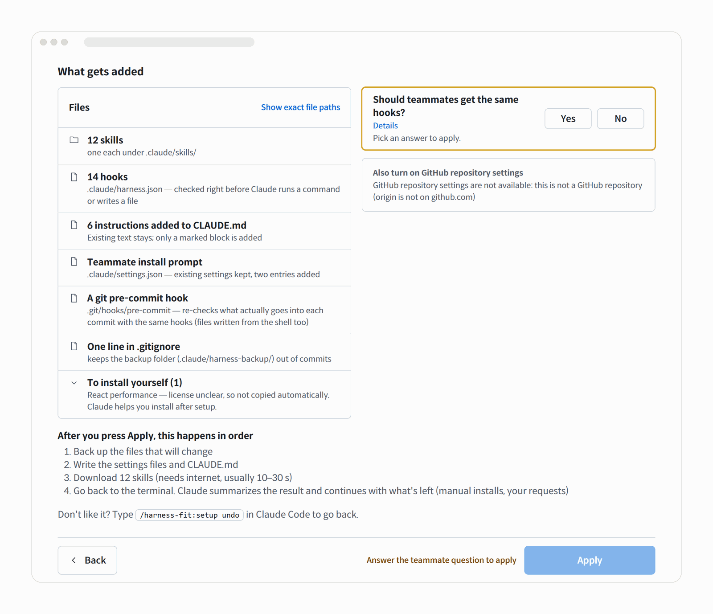

# harness-fit guide

> Last updated: 2026-11-09 · The detailed parts moved out of the README: the screens, hooks, team sharing and GitHub settings

If you are new, the [README](../README.en.md) is enough. Read only the parts you need here.

- [The 6 steps in detail](#the-6-steps-in-detail)
- [Working with teammates](#working-with-teammates)
- [When you already have something](#when-you-already-have-something)
- [GitHub repository settings](#github-repository-settings)
- [The 23 hooks](#the-23-hooks)
- [Hooks each combo turns on](#hooks-each-combo-turns-on)
- [Hook options](#hook-options)
- [Git pre-commit hook](#git-pre-commit-hook)
- [Letting one line through](#letting-one-line-through)
- [When a hook crashes](#when-a-hook-crashes)
- [Tokens used by hooks](#tokens-used-by-hooks)
- [Skill listing limit](#skill-listing-limit)
- [Where do the skills come from?](#where-do-the-skills-come-from)
- [Undo in detail](#undo-in-detail)
- [Working on this repo](#working-on-this-repo)

## The 6 steps in detail

One question per screen. The step tabs at the top and the "Your picks" summary on the right jump to any step, and every step has its own address (`#combo` …), so the browser's Back button works too.

`npx github:HwangSlater/harness-fit` reads the repo in the current folder and opens the picker in your browser (`cli/harness-fit.js`). This is for browsing: hooks only run through the plugin, so applying without it writes the settings file but blocks nothing (the picker says so, and the CLAUDE.md instructions are written as if the hooks were off).

1. **How much should Claude help?** (combo & branch strategy) Light · Solo · Team · Thorough. "What it turns on" on each card previews its skills, hooks and instructions. Stack-specific skills (React, Supabase, GitHub Actions…) are added automatically. Below the combos you pick a **branch strategy** (GitHub Flow · Git Flow · Trunk-based · None); the related hooks follow your choice. Each strategy is drawn as a git graph with branch colours (main blue, develop purple, feature green, release yellow).
2. **Which skills should go in?** Click chips to turn skills on or off in each stage: plan → design & UI → build → test & debug → review & security → ship. "Also recommended" is matched to your stack; "See all skills" searches the catalog (78 of the 81 — the 3 that do a hook's job are left out). In that window each skill shows a plain one-line effect, when to use it, tokens and source, and — when there is a real cost — a "Keep in mind" note (many tokens when used, slower because of questions or checks, a separate tool to install, …). If a skill doing the same job is already picked, you see "A similar skill is already in"; click the name to jump to that skill and switch either one on or off.
3. **Which mistakes should be blocked?** The 23 hooks in 6 groups (Secrets & danger / Git history / Code / Per language / Way of working / Saving tokens). "Details" shows what each one blocks, a "Keep in mind" note (false blocks, extra steps, tokens for notice hooks) and its options. A hook left off because it doesn't match this repo's history says why in one line (e.g. "Off by default: this repository's commits don't follow this format (4 of the last 30)"). "Blocking only" turns on just the hooks that block a command or file write and fit this repo, and turns off the notice-only ones (Report commit hashes, Work checklist, Answer language, Read GitHub with gh).
4. **Which instructions go into CLAUDE.md?** The exact text that will be written, matched to the hooks you turned on, is previewed on the right (short / full). The top block, **"Commands in this repo"**, lists the test, lint, type-check, format and build commands read from package.json scripts (using pnpm, yarn or bun when their lockfile is there), Makefile, pyproject (pytest, ruff, mypy, tox, hatch), Cargo and go.mod. Only what the repo really has goes in; if nothing is found, or your CLAUDE.md already lists them, it is left out. When the test runner is certain (vitest, jest, Playwright, bun, node --test, pytest, cargo, go), a "One test only" command is added too. Click an instruction (or press Enter or Space) to open a small dialog with its full description, the lines it adds to CLAUDE.md, the lines dropped because a hook or skill covers them, its size in lines and tokens, and an on/off switch. Turning on a chip under "Hooks that take over a line" lets that hook enforce the rule, so the overlapping line is dropped; "Show removed lines" shows the dropped lines struck through with the reason. Confusing spots, decisions that aren't in the repo and anything you've corrected twice are things Claude can't learn by reading the repo — write them yourself outside the harness-fit markers (e.g. "`src/legacy/` is still used, but new code doesn't follow it.").
5. **Anything else?** Write "commit messages in English" and Claude applies it after setup.
6. **Apply this?** Every pick has a "Change" link back to its step, and you see what gets added where. Notices (an existing git hook, no plugin, the skill listing limit, …) show a one-line title; the rest is under "Details". Only the "Apply" button on this step applies (the summary card's "Review before applying" brings you here).

<div align="center">

</div>

When it's applied, Claude summarizes the result and continues with what's left (skills to install yourself, requests you typed on the screen). The final screen lists what went where by kind, the names to call the new skills with (`/name`), and what to do so teammates get it too.

**Reopening starts from your previous selection.** Opening `/harness-fit:setup` again in a project you already set up starts from what you applied last time (hooks you turned off stay off), not a fresh recommendation; skills, hooks and instructions added since then start off and are marked "New". "Reset to recommended" leaves "Restore previous choice" in the same place. `auto` keeps your previous selection too and only names what's new.

## Working with teammates

If you picked a branch strategy, the review step asks **"Should teammates get the same hooks?"** and Apply stays locked until you answer. "Yes" adds an install prompt to `.claude/settings.json` and shows, before and after applying, what teammates need: the files to commit and push, the install prompt they get when opening the repo, and that the git pre-commit hook has to be applied on each teammate's PC.

- `.claude/settings.json`: teammates who open the repo are prompted to install this plugin (pinned version). Existing settings are kept; two entries are added.
- The git hook is not part of the repo, so each teammate gets it by opening `/harness-fit:setup` on their PC and applying as is ([git pre-commit hook](#git-pre-commit-hook)).
- With team sharing on, hooks and skills that exist only on this PC (global settings) do not count as overlap — teammates don't have them.

## When you already have something

- **Hooks**: your existing hooks (user and project settings, other plugins) are run with sample inputs. If one already blocks the same thing, harness-fit's hook starts off with the label "A hook you already use does the same job". Click it to see that hook's name, where it is set (user settings, project settings, a plugin) and a one-line test result in a small dialog. Hooks that block before a write (PreToolUse) and Stop, SessionStart and UserPromptSubmit hooks are compared with hooks of the same event; hooks that report afterwards (PostToolUse) are not treated as the same. The test runs in a temporary repo and home folder and takes a few seconds, so nothing is left in your settings folder; each existing hook is called once per sample input (dozens of times), so a hook that logs records that many. Hooks inside the repo are only test-run when opened from Claude Code.
- **Skills**: a skill with the same name is left out. Click its label to see where it is installed (user, project or plugin skill) and its description. Skills with a different name that do the same job are picked out by Claude at setup from their names and descriptions.
- **CLAUDE.md**: lines your project or global CLAUDE.md, or your own `.claude/rules/`, already say are left out by Claude. Things a hook enforces are not repeated as instruction text.
- **With team sharing on**, hooks and skills that exist only on this PC (global settings) do not count as overlap.
- Within harness-fit, skills that do the same job (e.g. "Test first" and "Light test-first") are never in a combo together (`catalog/overlaps.json`).

## GitHub repository settings

Hooks only see the commands Claude runs. Merging from the GitHub web UI, through `gh api`, or by another person gets past them. So the review step has "Also turn on GitHub repository settings". **It is off by default.** Turned on, you pick the items below one by one. Recommended values are preselected, but the right answer differs per team, so you decide each one. It applies to everyone who uses the repository, so the picker lists what changes (now → after) for the chosen items before anything is changed.

| Item | GitHub Flow | Git Flow | Trunk-based |
| --- | --- | --- | --- |
| Squash merging only (merge-commit and rebase buttons go away) | on | not offered | not offered |
| Automatically delete merged branches | on | not offered | not offered |
| Require a pull request before merging | on | **off** — release and hotfix are merged locally and pushed | not offered |
| Required approvals (0, 1, 2) | 0 | 0 | not offered |
| Block force pushes | on | on | on |
| Block deletion | on | on | on |
| Include administrators (you cannot push straight to the branch either) | on | on | on |

Protected branches: the default branch for GitHub Flow and trunk-based, main (or master) and develop for Git Flow. None offers nothing.

- With 1 or more required approvals someone else has to approve, so a solo owner can no longer merge their own PR.
- An item left off means "leave as is": nothing already on in GitHub is turned off, and existing protection settings (status checks etc.) are kept.
- Available when origin is a github.com repository, `gh` is installed and logged in, and you are an admin of the repository. Otherwise the picker says why in one line, with "Check again" if you were offline or not logged in.
- On free accounts, GitHub does not allow branch protection on private repositories (Pro or Team needed). The picker says those items will be skipped; only the merge settings can be chosen.
- Without the picker (`auto`), Claude shows the items with their recommended values and passes only the ones you pick (`--github-settings=squash,pr:main,…`).
- Undo puts the changed settings back. Values someone changed on GitHub since then are left alone.

## The 23 hooks

Rules that need no judgment are enforced by hooks, not prose, and you only hear from them when they fire. A hook only exists if it can catch every form it promises; things that would need guessing (hard-coded values, SQL/shell injection, secrets in logs) stay as instructions and skills instead (the one heuristic hook, "Answer language", is harmless when it misses, so it is an opt-in, off by default). Every hook has tests that feed "must block" and "must pass" inputs through the real entry point (`hooks/test/strict.test.mjs`).

**Secrets & danger**

| Hook | Blocks |
| --- | --- |
| Block secrets | GitHub/AWS/OpenAI/Slack/Google/Stripe keys, private keys, JWT-shaped strings and `password = "real value"` written to files or commits (listed forms only) |
| Protect .env & key files | Writing or committing `.env`, certificates and SSH keys |
| Block dangerous commands | Wiping with `rm -rf ~` or `Remove-Item -Recurse`, `curl … \| sh`, `irm … \| iex`, `chmod 777`, `reset --hard` over uncommitted work (listed forms only) |
| Block passwords on the command line | `mysql -pSECRET`, `curl -u user:pass`, `PGPASSWORD=value`, `postgres://user:pass@` (listed forms only) |

**Git history**

| Hook | Blocks |
| --- | --- |
| Block git add -A | `git add .`, `-A`, `-u` without paths, `git commit -a` — stage only what you changed |
| Protected branches | Direct commits (including `cherry-pick`, `revert`, `am`), force-pushes and remote deletes on main (with GitHub Flow, direct pushes too; `merge` is allowed) |
| Commit message format | `feat:` / `fix:` style, subject up to 72 chars; asks for a direct message when it cannot read one |
| Branch naming | New branches (`switch -c`, `checkout -b`, `branch`, `worktree add -b`) must start with `feature/`, `fix/`, … |
| Block --no-verify | `--no-verify`, `commit -n`, `HUSKY=0`, `SKIP=`, changing `core.hooksPath` |
| Block rewriting pushed commits | `git commit --amend` or `git rebase` on commits already pushed (`git pull --rebase` is fine) |
| PR merge style | `gh pr merge` without `--squash` and `--delete-branch` (GitHub Flow only) |
| Block unsquashed pushes | `git push` with two or more commits that are not on the remote, with how to squash them via `git reset --soft` (teams differ, so it is off in every combo) |

**Code**

| Hook | Blocks |
| --- | --- |
| Block large new files | New code files over 400 lines (also files first added by a commit) |
| Block unsafe HTML | `innerHTML =`, `dangerouslySetInnerHTML`, `v-html`, `eval(`, `new Function(` |
| Pin dependency versions | Ranges such as `^1.2.3`, `~1.2`, `latest` in package.json (also from `npm install`, at commit time; peerDependencies excluded) |
| Block GitHub Actions injection | `${{ github.event.issue.title }}` straight in `run:`, fetching PR code under `pull_request_target`, third-party actions at `@v1` instead of a commit SHA |

**Per language** (on in Solo, Team and Thorough when that stack is detected)

| Hook | Blocks |
| --- | --- |
| Block Swift try! and print | `try!`, `print(` and `debugPrint(` on new lines in `.swift` files (tests and vendored code excluded) |
| Block Python shell=True and eval | `shell=True`, `eval(` and `exec(` on new lines in `.py` files (tests and vendored code excluded) |

**Way of working** (checked when Claude finishes an answer, a session starts or you send a message)

| Hook | Does |
| --- | --- |
| Report commit hashes | Asks once when an answer leaves out the hash of a commit made in that turn (off by default) |
| Work checklist | Gives each session a checklist file and shows what is left when you send a message (never blocks, off by default) |
| Docs format check | Only docs and images in `docs/`; `# Title`, date line and index link for changed docs (off by default) |
| Answer language | Asks for a rewrite when the final answer is not in the chosen language (a word-count heuristic, so off by default) |

**Saving tokens**

| Hook | Does |
| --- | --- |
| Read GitHub with gh | Tells Claude in one line to read GitHub with `gh` when it fetches a GitHub page (never blocks) |

- Shell hooks read the command text and what runs inside `bash -c "…"` or `pwsh -Command "…"`. They cannot see inside script files or git aliases.
- Exactly what each hook blocks is under "Details" → "More" in the picker (`detail` in `catalog/packs.json`).
- Hooks run once per tool call, read the settings once and load only the hooks turned on for that kind of tool (shell, file write, web). If none are on for that kind, git isn't even started.
- Installing the plugin does nothing in projects without `.claude/harness.json` (the hook modules are not even loaded).

## Hooks each combo turns on

| Combo | Hooks on by default |
| --- | --- |
| Light | the 4 Secrets & danger hooks |
| Solo | the 4 Secrets & danger hooks, Block unsafe HTML, Block GitHub Actions injection, Read GitHub with gh |
| Team | Solo + Block git add -A, Protected branches, Commit message format, Branch naming, Block --no-verify, Block rewriting pushed commits, PR merge style (GitHub Flow) |
| Thorough | Team + Block large new files, Pin dependency versions |

- When that stack is detected, Solo, Team and Thorough also get the Swift or Python hook.
- The branch strategy turns hooks on and off: GitHub Flow turns on Protected branches, Branch naming and PR merge style; Git Flow turns off PR merge style; trunk-based turns off Branch naming and PR merge style; None turns off all three.
- **Commit message format** is on by default only when at least 70% of the last 30 commit subjects follow it, and **Branch naming** only when at least 70% of branch names (other than main, master, develop and the default branch) follow the strategy's pattern. Turned on in a repo that doesn't follow them, they would block the very first commit. With fewer than 5 commits or 3 branches, the repo counts as new and they are on.
- **Pin dependency versions** is on only in Thorough, and never for a library package (package.json has `main`, `exports` or `types` and is not `private: true`): exact pins in a library make consumers install several copies of the same package.
- Report commit hashes, Work checklist, Docs format check, Answer language and Block unsquashed pushes are off in every combo (they differ per person and team). You can still turn them on.

## Hook options

"Details" in step 3 shows only the options a hook actually reads. Values a branch strategy sets (protected branches, blocking direct pushes, branch name prefixes) become the defaults when you pick that strategy; a value you change stays when you switch strategies.

| Hook | Options |
| --- | --- |
| Block secrets | Accept allow comments (off by default) |
| Protect .env & key files | Extra files and folders |
| Protected branches | Branch list, block direct pushes too, allow direct commits |
| Commit message format | Format (type: summary / any), language (any, Korean, English), subject limit (50, 72, 100) |
| Branch naming | Allowed prefixes (GitHub Flow list / Git Flow list) |
| Block large new files | Line limit (300, 400, 600, 800) |
| Docs format check | Check the date line |
| Answer language | Language (Korean, English, Japanese, Chinese) |

## Git pre-commit hook

- File hooks run on Write/Edit; files written from the shell or other tools (`cat >`, `sed -i`, `npm install`) are checked again with the same hooks at commit time. Applying adds a small git hook at `.git/hooks/pre-commit` that looks at what is actually being committed — also when a person commits outside Claude (undo removes it). The git hook is not part of the repo, so each teammate gets it by opening `/harness-fit:setup` on their PC and applying as is.
- If another pre-commit hook or `core.hooksPath` (husky, pre-commit, lefthook) already exists, it is not overwritten; you get one line to add to that hook. In that case, and in a teammate's fresh clone, the `git commit` command is read inside Claude Code instead, and a command that writes files and then commits is asked to run separately.

## Letting one line through

You don't have to turn a whole hook off. Add `lint:allow <hook id> <reason>` at the end of the line or in a comment line right above it, and only that line passes; you are told the hook id, file:line and reason every time (with no reason, or one shorter than 3 characters, it stays blocked).

```js
el.innerHTML = renderMarkdown(src); // lint:allow unsafe-html the renderer only returns DOMPurify-sanitised HTML
```

- Accepted by: Block unsafe HTML (`unsafe-html`), Block GitHub Actions injection (`gha-inject`), the Swift and Python hooks, Block large new files (`file-size`, within the first 10 lines), and Block secrets (`secrets`, only with the "Accept allow comments" option on — a real key is too easy to wave through with a comment).
- Not accepted by: Pin dependency versions (package.json has no comments), Protect .env & key files (it looks at files, not lines), and the hooks that read commands.
- The older `harness:allow <id> <reason>` form from 0.2.x is still accepted under the same rules.

## When a hook crashes

It lets the action through but does not go quiet: "harness-fit: the … hook crashed, so this action runs without it." (a notice line in Claude Code, terminal text for the git pre-commit hook). Blocking instead would leave Claude unable to fix even the settings file, and would stop people's commits too. If another hook finds something to block, it still blocks. A broken `.claude/harness.json` is reported too, rather than silently turning everything off.

## Tokens used by hooks

Hooks send Claude about one line (roughly 20–100 tokens) only when they fire: the reason for a block, the "Read GitHub with gh" tip, or the end-of-answer (Stop) follow-ups from Report commit hashes, Docs format check and Answer language. Only Work checklist adds text routinely: about 100 tokens at session start and, while items are left, about 50 tokens plus the items on each message. The checklist and the three Stop follow-ups are off by default.

The token table in the README was measured on an example Next.js · TypeScript · Supabase · Vitest · GitHub Actions repo (test (vitest), lint, typecheck and build scripts in package.json, 3 committers). Skill counts include one skill you install yourself (React performance), the instruction counts include "Commands in this repo", and the 6 in Team and Thorough also include the branch strategy (GitHub Flow).

## Skill listing limit

The space where Claude keeps the list of skill names and descriptions has a limit (8,000 characters by default, per the docs). Over it, newly added skills lose their descriptions first, so Claude may not pick them on its own (`/name` still works). The review step counts your user, project and enabled-plugin skills on this machine plus the new ones; at 80% of the limit or more it shows the numbers and a "Trim to recommended" button. Raising the limit (`skillListingBudgetFraction`) is explained, never changed for you. After setup, the Skills line in `/context` shows the real size.

## Where do the skills come from?

- 81 skills from 24 GitHub repositories with 1,000+ stars, updated within the last six months (`catalog/catalog.json`).
- A saved list goes stale, so every time the picker opens it reruns the same searches for **repositories that appeared or were updated after the catalog date** and lists them at the bottom of the skills step. They are not vetted, so nothing is installed; tick one and Claude reviews it after setup.
- "More" in "See all skills" shows each skill's source, license, pinned commit, any executable files it contains, and the original text.
- Only permissively licensed skills (MIT, Apache-2.0, …) are copied; others link to their own install instructions. Downloaded skills are never run.

Skills belong to their authors. The source is recorded in `.harness-source.json` inside each installed folder.

## Undo in detail

`/harness-fit:setup undo` or `npx github:HwangSlater/harness-fit --undo` restores the state before the last apply.

Files you edited after setup are not wiped: only the harness-fit block is taken out of CLAUDE.md and only its line out of `.gitignore`; other edited files are saved to the backup folder as you left them, then reverted, and you are told where. If you applied twice, undo goes back one apply at a time. If GitHub repository settings were turned on, they are set back first; anything that could not be set back is listed with the value to set by hand.

The backup folder (`.claude/harness-backup/`) is kept out of commits by one line in `.gitignore`.

## Working on this repo

| Command | What it does |
| --- | --- |
| `npm test` | All tests (before committing) |
| `npm run test:quick` | Everything except the large-input tests (while editing) |
| `npm run test:stress` | Only the 10 MB / 80 MB input and large-commit tests (`hooks/test/stress/`) |
| `node --test hooks/test/<name>.test.mjs` | One test file |
| `node cli/harness-fit.js` | Open the picker for the repo in the current folder |

There are no runtime dependencies (Node 18 or later, `node:` built-ins only). Why things are the way they are is in [decisions.md](decisions.md) (Korean).

## Change history
- 2026-11-09: Moved the detailed parts out of the README; added the combo defaults, plain effects and "Keep in mind" notes, the instruction dialog, overlap labels, git graph pictures and test commands to match the current code.
