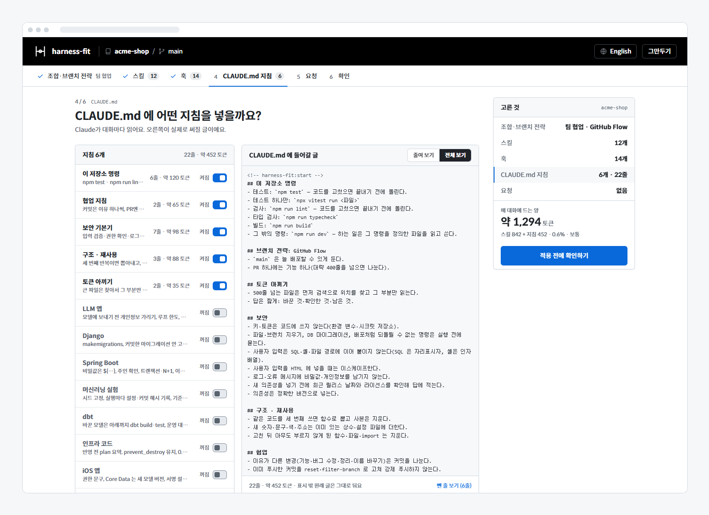
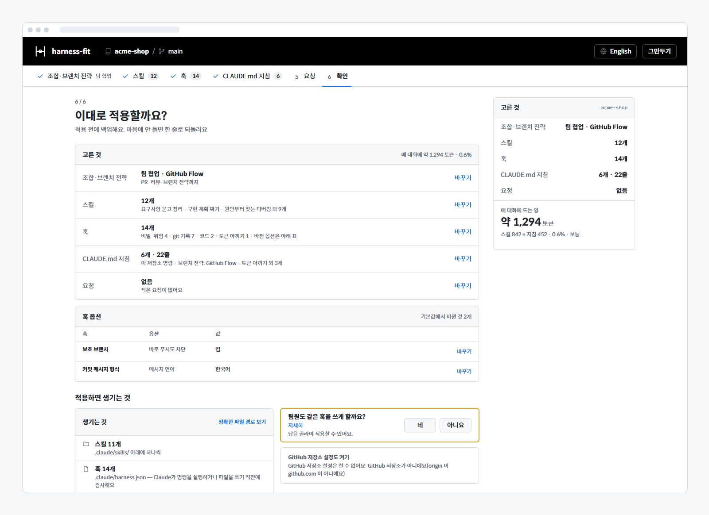
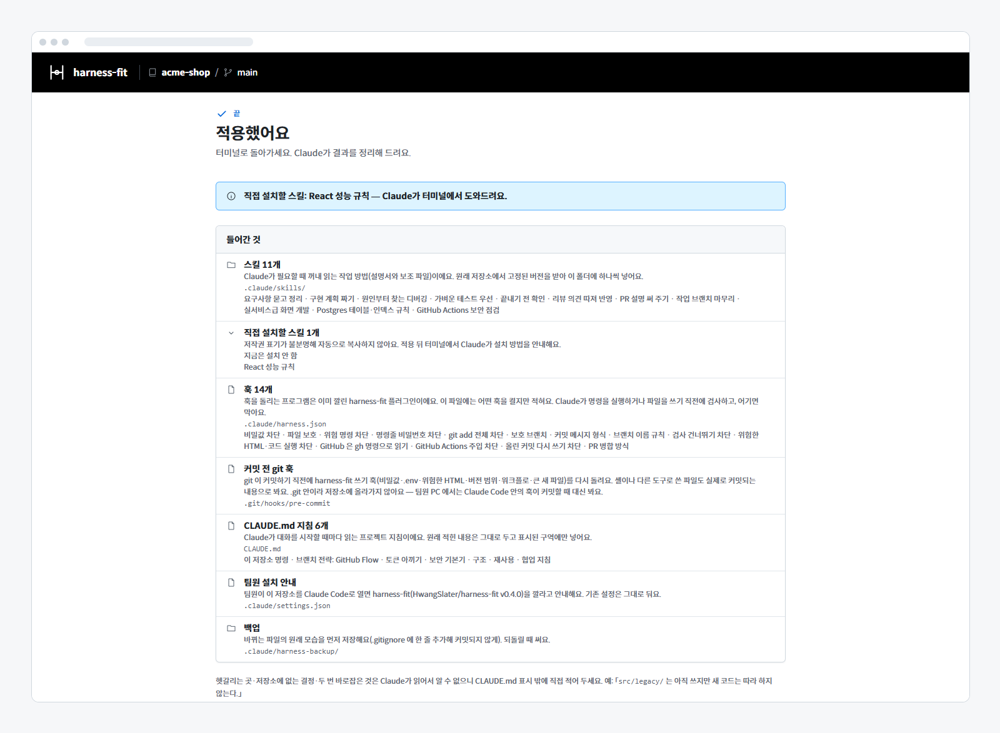
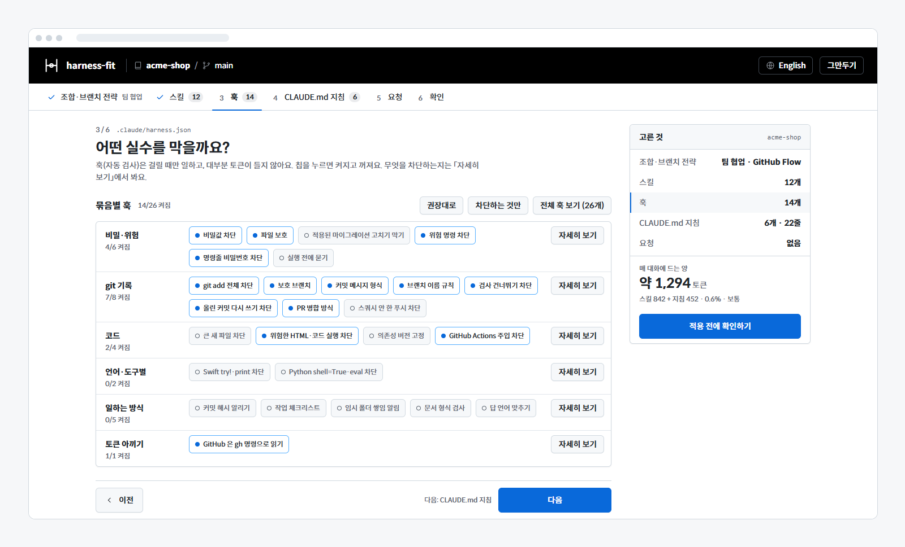
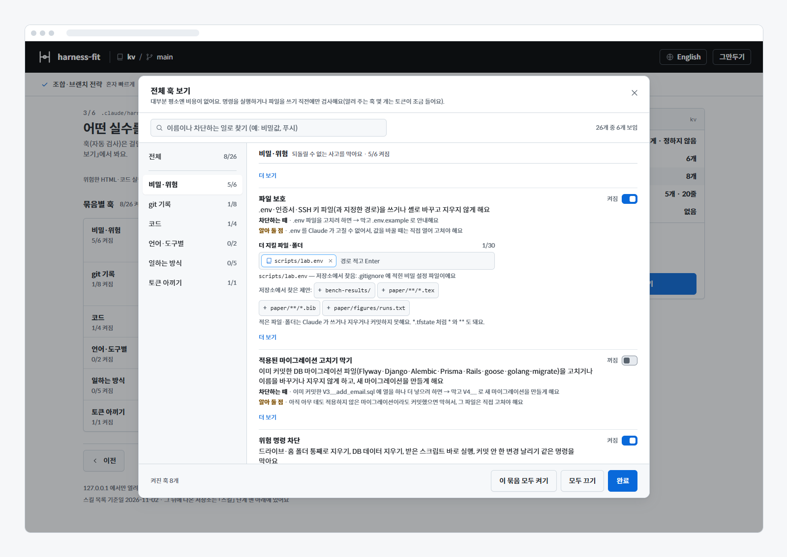

# harness-fit 자세한 안내

> 최종 수정: 2026-11-13 · README 에서 옮긴 화면·훅·팀 공유·GitHub 설정의 자세한 설명

처음이라면 [README](../README.md)만 읽어도 충분해요. 이 문서는 궁금한 항목만 찾아 읽으면 돼요.

- [화면 6단계 자세히](#화면-6단계-자세히)
- [팀원과 함께 쓰기](#팀원과-함께-쓰기)
- [이미 있는 것과 겹칠 때](#이미-있는-것과-겹칠-때)
- [GitHub 저장소 설정](#github-저장소-설정)
- [훅 26개](#훅-26개)
- [조합마다 기본으로 켜지는 훅](#조합마다-기본으로-켜지는-훅)
- [훅 옵션](#훅-옵션)
- [git 커밋 전 훅](#git-커밋-전-훅)
- [줄 하나만 넘기기](#줄-하나만-넘기기)
- [훅이 오류로 멈추면](#훅이-오류로-멈추면)
- [훅이 쓰는 토큰](#훅이-쓰는-토큰)
- [스킬 목록 한도](#스킬-목록-한도)
- [스킬은 어디서 왔나요](#스킬은-어디서-왔나요)
- [되돌리기 자세히](#되돌리기-자세히)
- [이 저장소를 고칠 때](#이-저장소를-고칠-때)

## 화면 6단계 자세히

한 화면에 질문 하나씩, 위쪽 단계 탭이나 오른쪽 「고른 것」 요약에서 아무 단계로나 바로 갈 수 있어요. 단계마다 주소(`#combo` …)가 있어 브라우저의 뒤로 가기도 돼요.

`npx github:HwangSlater/harness-fit` 로 열면 지금 폴더의 저장소를 읽고 브라우저에 고르기 화면이 열려요(`cli/harness-fit.js`). 둘러보기용이에요 — 훅은 플러그인으로만 돌아서, 플러그인 없이 적용하면 설정 파일만 생기고 아무것도 막지 않아요(화면에 알리고, CLAUDE.md 지침은 훅이 꺼진 것으로 보고 글로 넣어요).

1. **얼마나 챙길까요?** (조합·브랜치 전략) 가볍게 · 혼자 빠르게 · 팀 협업 · 꼼꼼하게 중 하나. 카드마다 「켜지는 것 보기」로 들어갈 스킬·훅·지침을 미리 봐요. 스택에 맞는 스킬(React, Supabase, GitHub Actions…)은 자동으로 더해져요. 같은 화면 아래에서 **브랜치 전략**(GitHub Flow · Git Flow · 트렁크 기반 · 정하지 않음)을 고르면 관련 훅도 같이 맞춰져요. 전략마다 갈래 색(main 파랑·develop 보라·feature 초록·release 노랑)을 칠한 git 그래프 그림으로 보여 줘요.
2. **어떤 스킬을 넣을까요?** 기획 → 설계·화면 → 만들기 → 테스트·디버깅 → 리뷰·보안 → 올리기·배포 묶음마다 칩을 눌러 켜고 꺼요. 「추가로 권장」은 저장소 스택에 맞춘 것, 「전체 스킬 보기」는 카탈로그 81개 가운데 훅과 같은 일을 하는 3개를 뺀 78개를 찾아보는 창이에요. 창의 스킬 줄마다 무엇이 달라지는지 쉬운 한 줄, 쓰는 때, 토큰·출처, 그리고 실제 대가가 있으면 「알아 둘 점」(꺼내 쓸 때 토큰이 많이 듦, 질문·확인 단계로 느려짐, 따로 깔 도구 등)을 보여 줘요. 같은 일을 하는 스킬이 이미 골라져 있으면 「비슷한 스킬이 이미 들어 있어요」 이름표가 붙고, 이름을 누르면 그 스킬 줄로 가서 둘 중 하나를 바로 켜고 끌 수 있어요.
3. **어떤 실수를 막을까요?** 훅 26개를 6개 묶음(비밀·위험 / git 기록 / 코드 / 언어·도구별 / 일하는 방식 / 토큰 아끼기)으로 보여 줘요. 「자세히 보기」에서 무엇을 차단하는지, 「알아 둘 점」(헛막음·늘어나는 단계·알림 훅의 토큰), 훅 옵션을 봐요. 이 저장소 기록과 맞지 않아 기본에서 뺀 훅은 그 이유를 한 줄로 알려요(예: 「이 저장소 커밋 기록이 이 형식이 아니라 기본에서 뺐어요(최근 30개 중 4개)」). 「차단하는 것만」을 누르면 명령·파일 쓰기를 차단하는 훅 가운데 이 저장소에 맞는 것만 켜고, 묻거나 알려 주기만 하는 훅(실행 전에 묻기·커밋 해시 알리기·작업 체크리스트·임시 폴더 쌓임 알림·답 언어 맞추기·GitHub 은 gh 명령으로 읽기)은 꺼요.

   훅 옵션은 한 줄에 하나씩 놓여요. 고르는 옵션은 선택지마다 설명 한 줄이 달린 메뉴이고, 목록 옵션(실행 전에 물을 명령·더 지킬 파일·폴더·지킬 브랜치·더 받을 타입)은 값마다 칩 하나예요. Enter 로 더하고 × 로 빼요. 쉼표나 줄바꿈이 든 글을 붙여 넣으면 나눠서 들어가요. 받지 않는 값은 빨간 칩으로 남고 그 이유가 칸 바로 아래에 나와요. 저장소에서 찾아 미리 넣은 값에는 찾은 이유가 한 줄씩 붙어요(예: 「Makefile 이 원격 스크립트(deploy.sh)를 불러요」, 「iOS 저장소의 기본값이에요」). 이유가 같은 값이 4개를 넘으면 앞 셋만 보이고 「외 N개」로 줄여요. 미리 넣지 않고 제안만 하는 값(커밋해 둔 결과·논문 폴더)은 칸 아래 「+ 값」 단추를 눌러 넣어요.
4. **CLAUDE.md 에 어떤 지침을 넣을까요?** 켠 훅에 맞춰 실제로 써질 글을 오른쪽에 미리 보여 줘요(줄여 보기 / 전체 보기). 맨 위 **「이 저장소 명령」**은 package.json scripts(pnpm·yarn·bun 잠금 파일이면 그 명령으로)·Makefile·pyproject(pytest·ruff·mypy·tox·hatch)·Cargo·go.mod·Gradle·Maven(래퍼가 있으면 `./gradlew`·`./mvnw`)·ROS 2 colcon·Django `manage.py` 에서 읽은 테스트·코드 검사(lint)·타입 검사·형식·빌드 명령이에요. Cargo 는 CI 설정(GitHub Actions·GitLab CI)에 적힌 옵션(`--workspace`·`-- -D warnings` 등)을 따라요. 「그 밖의 명령」 줄에는 개발 서버·마이그레이션 같은 package.json 스크립트, Makefile 대상, pyproject 가 설치하는 명령, Procfile 프로세스를 10개까지 넣어요. README·CONTRIBUTING 의 코드 블록과 GitHub Actions 의 `run:` 줄에 적힌 python 스크립트·모듈과 cargo 하위 명령도, 그 파일·패키지가 저장소에 실제로 있으면 뒤에 붙여요(설치·배포 절 아래, 배포·출시 워크플로, `ENV=prod` 같은 운영 값, 지우기·마이그레이션 낱말이 든 명령은 빼요). 저장소에 있는 것만 넣고, 하나도 없거나 내 CLAUDE.md 에 이미 적혀 있으면 넣지 않아요. 「실행 전에 묻기」에 든 명령(배포·출시 대상 등)은 평소 명령에서 빼요. 테스트 도구를 확실히 알 수 있으면(vitest·jest·Playwright·bun·node --test·pytest·cargo·go) 「테스트 하나만」 명령도 넣어요. 지침 줄을 누르면(또는 Enter·Space) 작은 창에서 설명 전체, CLAUDE.md 에 넣을 줄, 훅·스킬이 맡아서 뺀 줄, 줄 수·토큰을 보고 켜고 끌 수 있어요. 「줄을 대신 맡는 훅」 칩을 켜면 그 훅이 차단하니 겹치는 줄이 빠지고, 「뺀 줄 보기」로 훅·스킬이 맡아서(또는 이미 CLAUDE.md 에 있어서) 뺀 줄을 줄 그어 이유와 함께 볼 수 있어요. 헷갈리는 곳·저장소에 없는 결정·두 번 바로잡은 것은 Claude 가 저장소를 읽어도 모르니, harness-fit 표시 밖에 직접 적어 두세요(예: 「`src/legacy/` 는 아직 쓰지만 새 코드는 따라 하지 않는다.」).

<div align="center">

</div>

5. **더 바라는 게 있나요?** 「커밋 메시지는 한국어로 써 줘」처럼 적어 두면 적용 뒤 Claude 가 반영해요.
6. **이대로 적용할까요?** 고른 것마다 「바꾸기」로 돌아갈 수 있고, 무엇이 어디에 생기는지 보여 줘요. 알릴 것(이미 있는 git 훅, 플러그인 없음, 스킬 목록 한도 등)은 제목 한 줄만 보이고 나머지는 「자세히」로 펼쳐요. 켠 훅 가운데 기본값에서 바뀐 옵션은 「훅 옵션」 표(훅 · 옵션 · 값)로 모아 보여 주고, 「바꾸기」를 누르면 그 훅의 옵션 칸으로 가요. 저장소에 맞춰 넣은 값에는 표시가 붙고, 적용하지 않는 값이나 비워 둔 칸은 표 아래에 경고로 나와요. 적용은 이 단계의 「이대로 적용」 단추로만 해요(요약 카드의 「적용 전에 확인하기」는 이 단계로 데려가요).

   적용이 실패하면 까닭을 오류 종류에 맞춰 알려요(파일을 쓸 권한이 없음 · 디스크 공간이 모자람 · 다른 프로그램이 파일을 쓰는 중). 파일이 하나도 바뀌지 않았으면 그렇다고 말하고, 일부가 바뀌었을 수 있으면 되돌리기 명령(`/harness-fit:setup undo`)을 함께 보여 줘요. 화면과 연결이 끊겨 결과를 받지 못했을 때도 「적용 결과를 받지 못했어요」와 되돌리기 명령을 보여 줘요.

<div align="center">

</div>

적용이 끝나면 Claude 가 결과를 정리하고, 남은 일(직접 설치할 스킬, 화면에 적어 둔 요청)을 이어서 해 줘요. 끝 화면은 무엇이 어디에 들어갔는지 종류별로, 새 스킬을 부르는 이름(`/이름`)과 팀원에게 닿게 하려면 할 일을 보여 줘요. 받지 못한 스킬이 있으면 그 아래에 까닭을 적어요. GitHub 호출 한도에 걸렸으면 「약 N분 뒤에 다시 받을 수 있어요」처럼 언제 다시 받을 수 있는지 알려 줘요.

<div align="center">

</div>

**다시 열면 지난번 선택에서 시작해요.** 이미 적용한 프로젝트에서 `/harness-fit:setup` 을 다시 열면 새 권장이 아니라 지난번에 적용한 것(끈 훅은 꺼진 채)에서 시작하고, 그 뒤 새로 생긴 스킬·훅·지침은 꺼진 채 「새로 생김」으로 표시해요. 「권장으로 되돌리기」를 누르면 같은 자리에 「이전 선택으로 돌리기」가 떠요. `auto` 도 지난번 선택을 지키고 새것은 이름만 알려요.

## 팀원과 함께 쓰기

브랜치 전략을 정했으면 확인 단계에서 **「팀원도 같은 훅을 쓰게 할까요?」**에 꼭 답해야 적용돼요. 「네」면 `.claude/settings.json` 에 설치 안내를 넣고, 팀원이 할 일(커밋·푸시할 파일, 저장소를 열면 뜨는 설치 안내, git 커밋 전 훅은 팀원 PC 에서 따로 적용해야 한다는 점)을 적용 전·후에 보여 줘요.

- `.claude/settings.json`: 팀원이 저장소를 열면 이 플러그인(버전 고정)을 깔라고 안내해요. 기존 설정은 두고 두 항목만 더해요.
- git 훅은 저장소에 올라가지 않으니 팀원은 자기 PC 에서 `/harness-fit:setup` 을 열어 그대로 적용해야 생겨요([git 커밋 전 훅](#git-커밋-전-훅)).
- 팀원 공유를 켜면 이 PC 에만 있는 훅·스킬(전역 설정)은 겹침으로 보지 않아요. 팀원에게는 없으니까요.

## 이미 있는 것과 겹칠 때

- **훅**: 이미 쓰는 훅(전역·프로젝트 설정, 다른 플러그인)에 테스트 입력을 실제로 넣어 봐요. 같은 것을 막으면 harness-fit 쪽 훅은 꺼진 채로 시작하고 「이미 쓰고 있는 훅이 같은 일을 해요」 이름표를 붙여요. 이름표를 누르면 그 훅의 이름, 적힌 곳(사용자 설정·프로젝트 설정·○○ 플러그인), 테스트 결과 한 줄을 작은 창으로 보여 줘요. 쓰기 전에 막는 훅(PreToolUse)과 Stop·SessionStart·UserPromptSubmit 훅을 같은 때끼리 견주고, 쓴 뒤에 알려 주는 훅(PostToolUse)은 같은 것으로 보지 않아요. 이 테스트는 임시 저장소·임시 홈 폴더에서 돌아서 내 설정 폴더에는 결과 캐시(`~/.claude/harness-fit/probe-cache.json`)만 남고, 기존 훅마다 테스트 입력 수만큼(수십 번) 불려서 로그를 남기는 훅이면 그만큼 기록이 남아요. 처음에는 십몇 초 걸릴 수 있지만, 훅 설정·훅 스크립트·harness-fit 버전이 그대로면 다음부터는 캐시를 써서 거의 바로 끝나요(7일이 지나면 다시 테스트해요). 캐시에는 겹침 결과(스크립트 이름·자리)만 담고 명령 전체나 경로는 담지 않아요. 저장소에 들어 있는 훅은 Claude Code 안에서 열 때만 돌려 봐요.
- **스킬**: 같은 이름의 스킬이 이미 있으면 빼요. 이름표를 누르면 그 스킬의 자리(사용자 스킬·프로젝트 스킬·플러그인)와 설명을 보여 줘요. 이름은 달라도 하는 일이 같은 스킬은 설치를 시작할 때 Claude 가 이름과 설명을 보고 골라내요.
- **CLAUDE.md**: 프로젝트나 전역 CLAUDE.md, 직접 쓴 `.claude/rules/` 에 이미 같은 말이 있는 줄은 Claude 가 보고 빼요. 훅이 막아 주는 일은 지침 글로 다시 적지 않아요.
- **팀원 공유를 켜면** 이 PC 에만 있는 훅·스킬(전역 설정)은 겹침으로 보지 않아요.
- harness-fit 안에서도 같은 일을 하는 스킬(예: 「테스트 먼저 쓰기」와 「가벼운 테스트 우선」)은 조합에 함께 넣지 않아요(`catalog/overlaps.json`).

## GitHub 저장소 설정

훅은 Claude 가 치는 명령만 봐요. GitHub 웹 화면에서 병합하거나, `gh api` 로 보내거나, 다른 사람이 병합하는 길은 막지 못해요. 그래서 확인 단계에 「GitHub 저장소 설정도 켜기」를 뒀어요. **기본은 꺼짐**이고, 켜면 아래 항목을 하나씩 골라요. 권장 값이 미리 골라져 있지만 맞는 답은 팀마다 달라서 켜고 끄는 것은 직접 정해요. 이 저장소를 함께 쓰는 모든 사람에게 적용되니, 고른 항목의 바뀌는 값(지금 → 바뀐 뒤)을 보여 준 뒤에만 바꿔요.

| 항목 | GitHub Flow 권장 | Git Flow 권장 | 트렁크 기반 권장 |
| --- | --- | --- | --- |
| 스쿼시 병합만 허용(병합 커밋·리베이스 단추가 사라짐) | 켜짐 | 항목 없음 | 항목 없음 |
| 병합한 브랜치 자동 삭제 | 켜짐 | 항목 없음 | 항목 없음 |
| PR 로만 병합 | 켜짐 | **꺼짐** — release·hotfix 를 로컬에서 병합해 푸시해요 | 항목 없음 |
| 필요한 리뷰 승인 수(0·1·2) | 0 | 0 | 항목 없음 |
| 강제 푸시 차단 | 켜짐 | 켜짐 | 켜짐 |
| 브랜치 삭제 차단 | 켜짐 | 켜짐 | 켜짐 |
| 관리자에게도 적용(관리자인 나도 바로 푸시할 수 없어요) | 켜짐 | 켜짐 | 켜짐 |

보호하는 브랜치: GitHub Flow·트렁크는 기본 브랜치, Git Flow 는 main(없으면 master)과 develop. 정하지 않음은 항목이 없어요.

- 승인 수를 1 이상으로 하면 다른 사람이 승인해야 해서, 혼자 쓰는 저장소는 내 PR 을 병합할 수 없게 돼요.
- 끈 항목은 「그대로 두기」예요. GitHub 에 이미 켜져 있는 것을 끄지 않고, 있던 보호 설정(상태 검사 등)도 그대로 둬요.
- 켤 수 있는 때: origin 이 github.com 저장소이고, `gh` 가 설치·로그인돼 있고, 그 저장소의 관리자일 때. 아니면 화면에 이유를 한 줄로 알리고, 오프라인·로그인 전이었으면 「다시 확인」을 띄워요.
- 무료 계정의 비공개 저장소는 GitHub 이 브랜치 보호를 막아요(Pro·Team 이상). 그때는 보호 항목을 건너뛴다고 미리 보여 주고, 병합 방식만 고를 수 있어요.
- 화면 없이(`auto`) 쓸 때는 Claude 가 항목과 권장 값을 보여 주고, 고른 항목만 넘겨요(`--github-settings=squash,pr:main,…`).
- 되돌리기를 하면 바꾼 설정도 이전 값으로 돌아가요. 그 뒤 누가 GitHub 에서 다시 바꾼 값은 건드리지 않아요.

## 훅 26개

판단이 필요 없는 규칙은 글이 아니라 훅으로 막아요. 어길 때만 한 줄 안내해요. 훅은 약속한 패턴을 빠짐없이 막을 수 있는 것만 두고, 짐작해야 하는 것(값 바로 적기, SQL·셸 주입, 로그 속 비밀값)은 훅 대신 지침과 스킬로 둬요(짐작이 들어간 「답 언어 맞추기」는 놓쳐도 위험하지 않아 기본 꺼짐인 옵션으로만 둬요). 훅마다 「막는 것」과 「막지 않는 것」을 실제 진입점에 넣어 보는 테스트가 있어요(`hooks/test/strict.test.mjs`).

**비밀·위험**

| 훅 | 이렇게 하면 → |
| --- | --- |
| 비밀값 차단 | GitHub·AWS·OpenAI·Slack·Google·Stripe 키, 개인 키, JWT 모양 글자, `password = "실제값"`, 설정 파일(`.yml`·`.properties` 등)에 따옴표 없이 넣은 `password: 값`·`jwt.secret=값`, 브라우저 번들에 실리는 이름(`NEXT_PUBLIC_`·`VITE_` 등)으로 시작하면서 SECRET·PASSWORD 로 끝나는 변수를 쓰거나 커밋하면 막아요 (적어 둔 형식만) |
| 파일 보호 | `.env`·인증서·SSH 키 파일에 쓰거나 셸로 바꾸고 지우거나 커밋하지 않아요. 옵션 「더 지킬 파일·폴더」에는 `.gitignore` 처럼 `*`·`**` 글롭도 적을 수 있고(`*.tfstate*`), 그 경로는 `git rm`·`git checkout --`·`git restore` 로 바꾸는 것과 Claude 가 `git add`·`git commit` 으로 커밋에 넣는 것도 막아요 (사람이 직접 하는 커밋은 막지 않음) |
| 적용된 마이그레이션 고치기 막기 | 이미 커밋한 마이그레이션 파일(Flyway·Django·Alembic·Prisma·Rails·goose·golang-migrate)을 고치거나 이름을 바꾸거나 지우면 막고, 새 마이그레이션을 만들게 해요 |
| 위험 명령 차단 | `rm -rf ~`·`Remove-Item -Recurse` 로 통째 지우기, `curl … \| sh`·`irm … \| iex`, `chmod 777`, DB 데이터 지우기(`docker compose down -v`·`prisma migrate reset`·`manage.py migrate <앱> zero`·`flyway clean`·`dropdb` 등), 커밋 안 한 변경이 있을 때 `reset --hard` (적어 둔 형식만) |
| 명령줄 비밀번호 차단 | `mysql -p비밀번호`, `curl -u 아이디:비번`, `PGPASSWORD=값`, `postgres://아이디:비번@` (적어 둔 형식만) |
| 실행 전에 묻기 | 적어 둔 명령(예: `ros2 launch`, `python scripts/train.py`, `dbt build --target prod`)을 실행하기 전에 Claude Code 확인 창을 띄워요. 옵션 「실행 못 하게 막을 명령」에 적은 명령은 묻지 않고 막아요(같은 법으로 맞추고, `--dry-run` 을 붙여도 막음 — 사람이 직접 실행). 적은 옵션은 순서가 달라도 맞추고, `--dry-run`·`make -n` 같은 시험 실행은 묻지 않아요. 옵션 「원격·운영 명령도 묻기」(기본 켜짐)면 `ssh`·`scp`·원격 `rsync`, 바꾸는 `kubectl`·`helm`·`terraform apply`·`ansible-playbook`·`argocd`·`vault`, `aws`·`gcloud`·`az` 로 바꾸는 명령, 다른 호스트의 `psql`·`mysql`·`redis-cli`, 버전 태그 `git push`도 묻고, `aws secretsmanager get-secret-value`·`kubectl get secret -o yaml` 처럼 비밀값을 화면에 찍는 명령도 물어요. 확인할 사람이 없는 `claude -p`·CI 에서는 막혀요 |

**git 기록**

| 훅 | 이렇게 하면 → |
| --- | --- |
| git add 전체 차단 | `git add .`·`-A`·경로 없는 `-u`, `git commit -a` 대신 바꾼 파일만 |
| 보호 브랜치 | main 에 바로 커밋(`cherry-pick`·`revert`·`am` 포함)·강제 푸시·원격에서 지우기 (GitHub Flow 면 바로 푸시도, `merge` 는 허용) |
| 커밋 메시지 형식 | `feat:` / `fix:` 형식, 제목 72자 이하. 저장소 기록이 쓰는 표준 밖 타입(`bench:` 등)은 받을 타입으로 미리 채워요. 메시지를 읽을 수 없으면 바로 적게 해요 |
| 브랜치 이름 규칙 | 새 브랜치(`switch -c`·`checkout -b`·`branch`·`worktree add -b`)가 `feature/…`·`fix/…` 로 시작 |
| 검사 건너뛰기 차단 | `--no-verify`·`commit -n`, `HUSKY=0`·`SKIP=`, `core.hooksPath` 바꾸기 |
| 올린 커밋 다시 쓰기 차단 | 이미 푸시한 커밋을 `git commit --amend`·`git rebase` 로 고치기 (`git pull --rebase` 는 허용) |
| PR 병합 방식 | `--squash`·`--delete-branch` 없는 `gh pr merge` (GitHub Flow 에서만) |
| 스쿼시 안 한 푸시 차단 | 원격에 없는 커밋이 2개 이상인 채로 `git push` → `git reset --soft` 로 묶는 법을 알려 줘요 (팀마다 달라 모든 조합에서 기본 꺼짐) |

**코드**

| 훅 | 이렇게 하면 → |
| --- | --- |
| 큰 새 파일 차단 | 400줄 넘는 새 코드 파일 (커밋으로 처음 들어가는 파일도) |
| 위험한 HTML·코드 실행 차단 | `innerHTML =`·`dangerouslySetInnerHTML`·`v-html`·`eval(`·`new Function(`, 서버 템플릿(Django·Jinja)의 `\|safe`·`` |
| 의존성 버전 고정 | package.json 에 `^1.2.3`·`~1.2`·`latest` 같은 범위 버전 (`npm install` 로 들어간 것도 커밋할 때, peerDependencies 는 제외) |
| GitHub Actions 주입 차단 | `run:` 에 `${{ github.event.issue.title }}` 바로 넣기, `pull_request_target` 에서 PR 코드 받기, 남의 액션을 `@v1` 처럼 커밋 해시 없이 쓰기 |

**언어·도구별** (그 스택이 감지되면 혼자 빠르게·팀 협업·꼼꼼하게에서 켜져요)

| 훅 | 이렇게 하면 → |
| --- | --- |
| Swift try!·print 차단 | 새로 쓰는 `.swift` 줄의 `try!`·`print(`·`debugPrint(` (테스트 코드·받아 온 코드 제외) |
| Python shell=True·eval 차단 | 새로 쓰는 `.py` 줄의 `shell=True`·`eval(`·`exec(`, Django 의 `mark_safe(값)`·`csrf_exempt` (테스트 코드·받아 온 코드 제외) |

**일하는 방식** (Claude 가 답을 끝낼 때·세션을 시작할 때·메시지를 보낼 때 봐요)

| 훅 | 이렇게 하면 → |
| --- | --- |
| 커밋 해시 알리기 | 커밋한 턴의 답에 그 커밋 해시가 없으면 한 번 되물어요 (기본 꺼짐) |
| 작업 체크리스트 | 세션마다 체크리스트 파일을 주고, 메시지를 보낼 때 남은 항목을 보여 줘요 (막지 않음, 기본 꺼짐) |
| 임시 폴더 쌓임 알림 | 지난 세션이 Temp 에 남긴 작업 폴더가 쌓이면 세션을 시작할 때 하루 한 번 알리고, 지울지 사용자에게 묻게 해요 (직접 지우지 않음, 기본 꺼짐) |
| 문서 형식 검사 | `docs/` 에 문서·그림만, 바뀐 문서의 `# 제목`·날짜 줄·목차 링크 (기본 꺼짐) |
| 답 언어 맞추기 | 마지막 답이 고른 언어가 아니면 다시 쓰게 해요 (낱말 수로 보는 짐작이라 기본 꺼짐) |

**토큰 아끼기**

| 훅 | 이렇게 하면 → |
| --- | --- |
| GitHub 은 gh 명령으로 읽기 | GitHub 페이지를 가져오면 `gh` 로 필요한 것만 읽으라고 Claude 에게 한 줄 알려요 (막지 않음) |

<div align="center">

</div>

- 셸 훅은 명령 글에 적힌 것과 `bash -c "…"`·`pwsh -Command "…"` 안을 봐요. 스크립트 파일 안이나 git 별칭은 보지 못해요.
- 각 훅이 정확히 무엇을 막는지는 화면의 「자세히 보기」 → 「더 보기」(`catalog/packs.json` 의 detail)에 적혀 있어요.
- 훅은 도구를 부를 때마다 한 번 돌고, 설정을 한 번만 읽고 그 도구 종류(셸·파일 쓰기·웹)에 켠 훅만 불러와요. git 은 판정에 꼭 필요할 때만 띄워요. 저장소 맨 위·지금 브랜치·HEAD 는 `.git` 안의 파일에서 바로 읽어서, 팀 협업 조합에서 읽기만 하는 `git status` 에는 git 을 한 번도 띄우지 않고 `git commit` 에도 두 번이면 돼요(전에는 네 번·일곱 번).
- 플러그인을 깔아도 `.claude/harness.json` 이 없는 프로젝트에서는 아무것도 하지 않아요(훅 모듈도 불러오지 않아요).

## 조합마다 기본으로 켜지는 훅

| 조합 | 기본으로 켜지는 훅 |
| --- | --- |
| 가볍게 | 비밀값 차단, 파일 보호, 위험 명령 차단, 명령줄 비밀번호 차단 |
| 혼자 빠르게 | 가볍게 + 위험한 HTML·코드 실행 차단, GitHub Actions 주입 차단, GitHub 은 gh 명령으로 읽기 |
| 팀 협업 | 혼자 빠르게 + git add 전체 차단, 보호 브랜치, 커밋 메시지 형식, 브랜치 이름 규칙, 검사 건너뛰기 차단, 올린 커밋 다시 쓰기 차단, PR 병합 방식(GitHub Flow) |
| 꼼꼼하게 | 팀 협업 + 실행 전에 묻기, 큰 새 파일 차단, 의존성 버전 고정 |

- 혼자 빠르게·팀 협업·꼼꼼하게에서는 감지한 스택과 저장소 단서에 따라 이것들이 더해져요.
  - iOS(Swift)·Python → Swift·Python 훅
  - Flyway·Django·Alembic·Prisma·Rails·goose·golang-migrate → 적용된 마이그레이션 고치기 막기
  - Terraform·Kubernetes·Ansible·Claude API·MCP·PostgreSQL·Kafka·Redis → 실행 전에 묻기
  - 스택마다 물을 명령을 미리 채워요(화면 칩에 「○○ 저장소의 기본값이에요」로 까닭이 붙어요).
    - ROS 2 → `ros2 launch`·`ros2 topic pub`·`ros2 service call`·`ros2 action send_goal`·`ros2 bag play`·`ros2 param set`. `ros2 run` 은 넣지 않아요. rviz2·rqt 같은 보기용 도구도 `ros2 run` 으로 띄워서, 넣으면 매번 묻게 돼요.
    - iOS → 앱 올리기·공증·버전 바꾸기·인증서 명령(`xcrun altool --upload-app`·`xcrun notarytool submit`·`agvtool new-version`·`fastlane deliver`·`fastlane pilot upload`·`fastlane cert`·`fastlane sigh`·`fastlane match nuke`·`security delete-certificate`·`git push --follow-tags` 등). `notarytool history`·`security find-identity` 처럼 보기만 하는 명령은 묻지 않아요.
    - Vercel·Netlify·Firebase·Fly.io(설정 파일이 있으면) → 운영 배포와 환경 변수를 바꾸는 명령(`vercel --prod`·`netlify deploy --prod`·`firebase deploy`·`fly deploy`·`fly secrets set`·`vercel env pull` 등)
  - 저장소에서 찾은 것 → 실행 전에 묻기의 물을 명령으로: README·Makefile·셸 스크립트에 적힌 긴 학습·탐색 스크립트(train·tune·sweep), 원격에 닿거나 운영 옵션(`--target prod`)을 쓰는 배포 스크립트·Makefile 대상, 설명에 「리드만」이라고 적힌 Makefile 대상, 마이그레이션 되돌리기 대상, fastlane 출시 레인, dbt 운영 대상(`--target prod`)과 증분 모델의 `--full-refresh`, 이어 쓴 줄이나 ssh 로 보내는 운영 `spark-submit`, Rust 시험에 `#[ignore]` 가 있으면 `cargo test -- --ignored`
  - 저장소에서 찾은 것 → 파일 보호의 더 지킬 경로로: `.gitignore` 에서 비밀·개인정보라고 주석을 단 묶음, 비밀 설정 파일(`*.env`·dbt `profiles.yml`), 원본 데이터 폴더(`/data/`)·데이터·체크포인트 파일(`.parquet`·`.ckpt` 등), 인프라 상태 파일(`*.tfstate*`·kubeconfig)
  - 커밋해 둔 결과·논문 폴더(데이터 파일만 든 `bench-results/`·`results/`, 논문 원고 `paper/**/*.tex`·`*.bib`, 그림 스크립트가 읽는 원자료) → 미리 넣지 않고 적용할 때 파일 보호에 넣을지 물어요. 화면에서는 칸 아래 「+ 값」 단추로 제안해요. 학위 논문 저장소처럼 원고가 저장소의 절반을 넘거나, 시험이 기대값으로 읽는 폴더면 묻지 않아요.
  - GitLab 저장소 → GitHub 전용인 「GitHub 은 gh 명령으로 읽기」·「PR 병합 방식」 훅과 PR 쓰기 스킬을 기본에서 빼요. 앱 코드 없이 인프라 코드만 있는 저장소 → 테스트 우선 스킬(테스트 먼저 쓰기·가벼운 테스트 우선)을 기본에서 빼요. 뺀 것마다 이유를 한 줄로 알려요.
  - CLAUDE.md 지침 묶음: Claude API → 「LLM 앱」(모델에 보내기 전 개인정보 가리기, 루프 한도, 시험은 가짜 클라이언트, 바꾸면 평가 셋), Django → 「Django」(makemigrations, 커밋한 마이그레이션 안 고치기, 운영 설정은 묻기, 템플릿 `|safe`·csrf, Celery 인자는 id), Spring Boot → 「Spring Boot」(비밀값은 `${…}`, 주인 확인, 트랜잭션·N+1, 이벤트·응답 형식은 더하기만, 오류 응답에 내부 정보 없음), PyTorch·scikit-learn·XGBoost·MLflow·Optuna·Hydra·wandb → 「머신러닝 실험」(시드 고정, 실행마다 설정·커밋 해시 기록, 기준과 견주기, 체크포인트 덮어쓰지 않기), dbt → 「dbt」(바꾼 모델은 하위 모델까지 `dbt build`·`test`, `--target prod` 는 묻기, 테스트 약하게 하지 않기, seeds·snapshots 지키기), Terraform(OpenTofu 포함)·Ansible → 「인프라 코드」(반영 전 plan 요약, `prevent_destroy` 유지, `0.0.0.0/0`·공개 버킷 막기, state 커밋 안 함, 버전 고정), iOS → 「iOS 앱」(권한 문구, Core Data 는 새 모델 버전, 서명 설정은 묻기, 강제 언래핑 대신 `guard let`), Rust → 「Rust」(`unsafe` 는 묻고 `// SAFETY:` 주석, clippy·test 는 CI 와 같은 옵션으로, 라이브러리엔 `unwrap()` 대신 `?`), 결제 SDK 의존성(stripe·토스페이먼츠·포트원 등)이나 원장·결제·정산 코드 → 「결제·돈 계산」(금액은 최소 단위 정수, 반올림 규칙은 묻고 바꾸기, 멱등성 키·웹훅 중복 거르기, 원장은 반대 기록, 카드 번호 로그 안 남기기)
- 브랜치 전략이 훅을 켜고 꺼요: GitHub Flow 는 보호 브랜치·브랜치 이름 규칙·PR 병합 방식을 켜고, Git Flow 는 PR 병합 방식을, 트렁크 기반은 브랜치 이름 규칙·PR 병합 방식을, 정하지 않음은 셋 다 꺼요.
- **커밋 메시지 형식**은 최근 커밋 제목 30개 중 70% 이상이 그 형식일 때만, **브랜치 이름 규칙**은 main·develop 같은 기본 브랜치를 뺀 브랜치 이름 70% 이상이 그 전략의 형식일 때만 기본으로 켜요. 안 따르는 저장소에 켜면 첫 커밋부터 막혀서예요. 커밋이 5개·브랜치가 3개보다 적으면 지킬 기록이 없는 새 저장소로 보고 켜요.
- **의존성 버전 고정**은 꼼꼼하게에서만, 그리고 라이브러리 패키지(package.json 에 `main`·`exports`·`types` 가 있고 `private: true` 가 아님)에는 켜지 않아요. 라이브러리가 정확한 버전으로 고정하면 쓰는 쪽에 같은 패키지가 여러 벌 깔려요.
- 커밋 해시 알리기·작업 체크리스트·임시 폴더 쌓임 알림·문서 형식 검사·답 언어 맞추기·스쿼시 안 한 푸시 차단은 어느 조합에서도 기본으로 켜지 않아요(사람마다·팀마다 달라서). 직접 켤 수는 있어요.

## 훅 옵션

<div align="center">

</div>

3단계의 「자세히 보기」에서 그 훅이 실제로 읽는 옵션만 보여요. 브랜치 전략이 정하는 값(지킬 브랜치, 바로 푸시도 차단, 브랜치 이름 시작)은 전략을 고르면 그 값이 기본이 되고, 직접 바꾼 값은 전략을 바꿔도 남아요.

| 훅 | 옵션 |
| --- | --- |
| 비밀값 차단 | 허용 주석 받기(기본 꺼짐) |
| 파일 보호 | 더 지킬 파일·폴더(`*`·`**` 글롭 가능) |
| 실행 전에 묻기 | 실행 전에 물을 명령, 원격·운영 명령도 묻기(기본 켜짐) |
| 보호 브랜치 | 지킬 브랜치, 바로 푸시도 차단, 바로 커밋은 허용 |
| 커밋 메시지 형식 | 메시지 형식(type: 요약 / 보지 않음), 메시지 언어(보지 않음·한국어·영어), 첫 줄 최대 길이(50·72·100자), 더 받을 타입 |
| 브랜치 이름 규칙 | 허용할 시작 이름(GitHub Flow 목록 / Git Flow 목록) |
| 큰 새 파일 차단 | 최대 줄 수(300·400·600·800) |
| 문서 형식 검사 | 날짜 줄 검사 |
| 답 언어 맞추기 | 답 언어(한국어·영어·일본어·중국어) |

## git 커밋 전 훅

- 파일 훅은 Write·Edit 로 쓸 때 보고, 셸이나 다른 도구로 쓴 파일(`cat >`·`sed -i`·`npm install`)은 커밋할 때 같은 훅으로 다시 봐요. 적용하면 `.git/hooks/pre-commit` 에 작은 git 훅을 넣어, 커밋하는 순간 실제로 들어가는 내용을 봐요 — 사람이 Claude 밖에서 직접 커밋할 때도 같아요(되돌리기로 빠져요). git 훅은 저장소에 올라가지 않으니 팀원은 자기 PC 에서 `/harness-fit:setup` 을 열어 그대로 적용해야 생겨요.
- 이미 다른 pre-commit 훅이나 `core.hooksPath`(husky·pre-commit·lefthook)가 있으면 덮어쓰지 않고, 그 훅에 이어 붙일 한 줄을 알려 줘요. 그때와 팀원이 새로 받은 저장소에서는 Claude Code 안에서 `git commit` 명령을 읽어 보는데, 같은 명령 앞부분에서 파일을 쓰고 바로 커밋하면 미리 볼 수 없어 나눠 실행하게 해요.

## 줄 하나만 넘기기

잘못 막혔다고 훅 전체를 끄지 않아도 돼요. 그 줄 끝이나 바로 위 주석 줄에 `lint:allow <훅 id> <이유>` 를 달면 그 줄만 통과하고, 쓸 때마다 훅 id·파일:줄·이유를 알려요(이유가 없거나 3자보다 짧으면 그대로 막아요).

```js
el.innerHTML = renderMarkdown(src); // lint:allow unsafe-html 렌더러가 DOMPurify 를 거친 HTML 만 돌려줌
```

- 받는 훅: 위험한 HTML·코드 실행 차단(`unsafe-html`)·GitHub Actions 주입 차단(`gha-inject`)·Swift·Python 훅, 큰 새 파일 차단(`file-size`, 파일 맨 위 10줄 안), 비밀값 차단(`secrets`, 옵션 「허용 주석 받기」를 켰을 때만 — 진짜 키에 주석 하나 달아 넘기기 쉬워서).
- 받지 않는 훅: 의존성 버전 고정(package.json 에 주석을 못 달아서), 파일 보호와 적용된 마이그레이션 고치기 막기(줄이 아니라 파일을 봐서), 명령을 보는 훅.
- 0.2.x 때 달아 둔 옛 형식 `harness:allow <id> <이유>` 도 같은 규칙으로 계속 받아요.

## 훅이 오류로 멈추면

막지 않고 통과시키되, 조용히 꺼지지 않게 알려요 — 「harness-fit: ○○ 훅이 오류로 멈춰서 이번 작업은 그 훅 없이 진행돼요」(Claude Code 안에서는 알림 줄, git 커밋 전 훅은 터미널 글). 막아 버리면 그 프로젝트에서 Claude 가 설정 파일조차 고칠 수 없고, 사람의 커밋도 멈추기 때문이에요. 다른 훅이 막을 것을 찾으면 그대로 막아요. `.claude/harness.json` 이 깨졌을 때도 조용히 모두 끄지 않고 알려요.

## 훅이 쓰는 토큰

훅은 걸렸을 때만 Claude 에게 한 줄 남짓(약 20~100 토큰)을 보내요: 차단 이유, 「GitHub 은 gh 명령으로 읽기」 안내, 답을 끝낼 때(Stop) 되묻는 「커밋 해시 알리기」·「문서 형식 검사」·「답 언어 맞추기」, 세션을 시작할 때 하루 한 번까지 알리는 「임시 폴더 쌓임 알림」. 늘 드는 것은 「작업 체크리스트」 하나로, 켜면 세션을 시작할 때 약 100 토큰, 남은 항목이 있으면 메시지마다 약 50 토큰 + 항목이 더해져요. 체크리스트와 Stop 때 되묻는 셋은 기본 꺼짐이에요.

README 의 토큰 표는 Next.js · TypeScript · Supabase · Vitest · GitHub Actions 예시 저장소(package.json 에 test(vitest)·lint·typecheck·build·dev 스크립트, 커밋한 사람 3명)에서 잰 값이에요(2026-11-13 에 빈 설정 폴더로 다시 잼 — 이미 있는 훅·스킬과 겹쳐서 빠진 것이 없어요). dev 스크립트는 「이 저장소 명령」의 「그 밖의 명령」 줄에 들어가요. 스킬 수에는 직접 설치할 스킬 1개(React 성능 규칙)가, 지침 수에는 「이 저장소 명령」이, 팀 협업·꼼꼼하게의 지침 6개에는 브랜치 전략(GitHub Flow) 지침도 들어 있어요.

## 스킬 목록 한도

Claude 가 스킬 목록(이름·설명)을 기억하는 자리에는 한도가 있어요(문서 기준 기본 8,000자). 넘으면 새로 넣은 스킬의 설명부터 빠져서, Claude 가 그 스킬을 알아서 꺼내 쓰기 어려워요(`/이름` 으로 부르면 그대로 써요). 확인 단계는 이 PC 의 사용자·프로젝트 스킬과 켜진 플러그인 스킬을 세어, 새 스킬을 더한 값이 한도의 80% 이상이면 숫자와 함께 알리고 「권장대로 줄이기」를 보여 줘요. 한도를 늘리는 설정(`skillListingBudgetFraction`)은 안내만 하고 바꾸지 않아요. 적용 뒤 실제 크기는 `/context` 의 Skills 줄에서 볼 수 있어요.

## 스킬은 어디서 왔나요

- GitHub star 1,000 이상, 최근 6개월 안에 업데이트된 저장소 24곳에서 고른 81개예요(`catalog/catalog.json`).
- 저장해 둔 목록은 금방 낡아요. 그래서 화면을 열 때마다 같은 검색어로 **목록 기준일 이후 새로 나오거나 업데이트된 저장소**를 다시 찾아 스킬 단계 맨 아래에 따로 보여 줘요. 검증 전이라 바로 설치하지 않고, 체크하면 적용 뒤 Claude 가 내용을 살펴봐요.
- 스킬마다 출처 · 라이선스 · 고정한 커밋 · 들어 있는 실행 파일 · 원문을 「전체 스킬 보기」의 「더 보기」에서 보여 줘요.
- MIT · Apache-2.0 처럼 복사가 허용된 라이선스만 파일로 설치해요. 나머지는 원래 저장소의 설치 방법을 안내해요. 받은 스킬은 실행하지 않아요.
- 받을 파일 목록은 고정한 커밋 기준으로 카탈로그에 적혀 있어서, 적용할 때 GitHub API 를 부르지 않고 원본 파일만 받아요(한 번에 6개씩 함께). 목록이 없는 옛 항목만 API 로 파일 목록을 읽고, 이때 `gh` 에 로그인돼 있으면 그 토큰을 API 호출에만 붙여요. GitHub 호출 한도에 걸리면 바로 멈추고 몇 분 뒤에 다시 받을 수 있는지 알려 줘요.

스킬은 각 저장소 작성자의 것이에요. 설치한 폴더의 `.harness-source.json` 에 출처를 남겨요.

## 되돌리기 자세히

`/harness-fit:setup undo` 또는 `npx github:HwangSlater/harness-fit --undo` 로 마지막 적용 전 상태로 돌아가요.

적용한 뒤 직접 고친 파일은 지우지 않아요. CLAUDE.md 는 harness-fit 구역만, `.gitignore` 는 넣은 한 줄만 빼고, 나머지 고친 파일은 고친 모습을 백업 폴더에 따로 남긴 뒤 되돌리고, 어디에 남겼는지 알려 줘요. 두 번 적용했으면 되돌리기도 한 번에 한 단계씩이에요. GitHub 저장소 설정을 켰다면 그것도 먼저 이전 값으로 돌리고, 돌리지 못한 항목은 직접 고칠 값과 함께 알려 줘요.

백업 폴더(`.claude/harness-backup/`)는 `.gitignore` 에 한 줄 더해 커밋되지 않게 해요.

## 이 저장소를 고칠 때

| 명령 | 하는 일 |
| --- | --- |
| `npm test` | 테스트 전부(커밋 전) |
| `npm run test:quick` | 큰 입력 테스트를 뺀 나머지(고치는 중에) |
| `npm run test:stress` | 10MB·80MB 입력·큰 커밋 테스트만(`hooks/test/stress/`) |
| `node --test hooks/test/<이름>.test.mjs` | 테스트 파일 하나 |
| `node cli/harness-fit.js` | 지금 폴더 저장소로 고르기 화면 열기 |

실행 의존성은 없어요(Node 18 이상, `node:` 내장 모듈만). 왜 이렇게 정했는지는 [decisions.md](decisions.md)에 있어요.

## 바뀐 이력
- 2026-11-09: README 에서 자세한 설명을 옮겨 처음 작성. 조합 기본값·쉬운 한 줄과 알아 둘 점·지침 창·겹침 이름표·git 그래프 그림·테스트 명령을 지금 코드에 맞춰 더함.
- 2026-11-11: 훅 26개로 맞춤 — 실행 전에 묻기·적용된 마이그레이션 고치기 막기·임시 폴더 쌓임 알림을 표에 더하고, 비밀값 차단·파일 보호·위험 명령 차단·위험한 HTML·코드 실행 차단·Python 훅 줄을 지금 동작에 맞춤. 스택·저장소 단서로 더해지는 훅·지침 묶음(LLM 앱·Django·Spring Boot)과 실행 전에 묻기 옵션을 적음.
- 2026-11-13: 스택에 딸린 지침 묶음 다섯(머신러닝 실험·dbt·인프라 코드·iOS 앱·Rust)을 적음.
- 2026-11-13: 적용된 마이그레이션 고치기 막기에 goose·golang-migrate 를 적음(훅·감지는 이미 다룸).
- 2026-11-13: 결제·돈 계산 지침 묶음과 커밋한 결과·논문 폴더를 적용 때 묻는 것을 적음.
- 2026-11-13: v0.4.0 에 맞춤 — 옵션 칩·까닭·「+」 제안·「외 N개」, 확인 단계 옵션 표와 실패 안내, 「이 저장소 명령」 읽는 곳, 실행 전에 묻기의 원격 범위와 스택별 기본 명령(iOS·배포 플랫폼, ros2 run 은 뺌), 인프라 코드 지침은 Terraform·Ansible 만, 겹침 시험 캐시, 스킬 받기 방식, 훅의 git 줄이기, 토큰 표 다시 잼.
